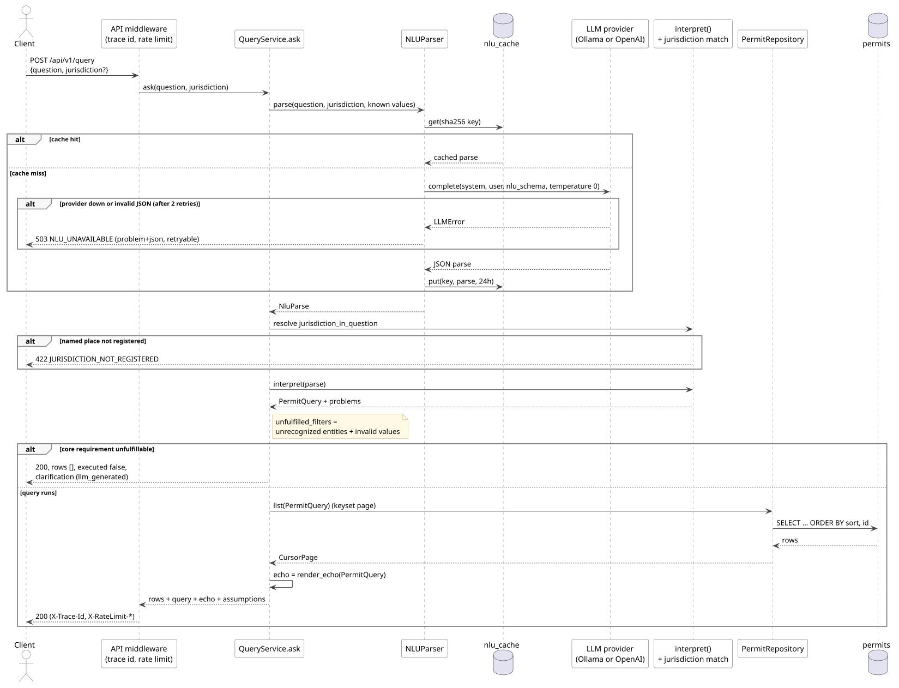

# Query API (Stage 04)

The query surface over the canonical store has four parts, all backed by one
implementation (`QueryService`, `src/permit_trade_skills/query/service.py`):

- **REST API** (`/api/v1/...`): structured search, status counts, single permit, jurisdictions.
- **Natural-language endpoint** (`POST /api/v1/query`): an LLM parses the question;
  code executes it and echoes back what ran.
- **Hybrid retrieval** (`query/retrieve.py`): structured filters plus trigram text plus
  pgvector, fused with RRF.
- **LLM tools** (`query/tools.py`): `search_permits`, `get_permit`, `permit_status_counts`,
  `list_jurisdictions`, for the agent stages.

The OpenAPI document is
[api/openapi.yaml](api/openapi.yaml), and is served live at `/docs` and `/openapi.json`.

## Running

```bash
uv run pts db migrate                 # adds the nlu_cache table (migration 0003)
uv run pts api serve --port 8000      # http://127.0.0.1:8000/docs
uv run pts api openapi                # regenerate docs/api/openapi.yaml
uv run pts query "pending permits applied for in the last 30 days" --json
```

`pts api serve` runs uvicorn on the app factory `permit_trade_skills.server:create_app`.
It uses the same database URL resolution as every other command: `--db-url`, then
`PERMIT_TRADE_SKILLS_DB_URL`, then the local default.

## Configuration: `config/settings.yaml`

| Setting | Default | Meaning |
|---|---|---|
| `llm.use_local_ollama_model` | `true` | `true`: every LLM role uses the `ollama` profile (`http://localhost:11434`, `qwen3.8:latest`). `false`: the `openai` profile (`gpt-4.1-mini`). Override per process with `PTS_USE_LOCAL_OLLAMA_MODEL=true\|false`. |
| `llm.providers.<p>.models` | `nlu.parser` per profile | The model per LLM role. |
| `llm.providers.<p>.api_key_env` | `OPENAI_API_KEY` / `OLLAMA_API_KEY` | The environment variable (shell or `.env`) that holds the key. Keys are never stored in the file. |
| `llm.providers.ollama.reasoning_effort` | `none` | Ollama thinking control. `none` gives about 1.5 s per parse instead of about 10 s. |
| `llm.timeout_s`, `llm.max_retries` | `120`, `2` | Per-request timeout. Retries with exponential backoff on transport errors, 429 and 5xx. |
| `api.rate_limit_per_minute` | `60` | In-process limit per client IP (`0` disables). Override with `PTS_RATE_LIMIT_PER_MINUTE`. |
| `nlu.cache_ttl_hours` | `24` | NLU parse cache lifetime. |

The settings file is found in this order: `$PTS_SETTINGS`, then the nearest
`config/settings.yaml` at or above the working directory, then the repository copy. A
missing key falls back to the built-in default.

Both profiles use the OpenAI-compatible chat-completions protocol
(`POST {base_url}/v1/chat/completions`) with strict JSON-schema output, through one
provider class (`llm/openai_compat.py`).

**Rate limiting.** The in-process limiter is fixed-window and per process, so it is not
shared across workers. Production deployments should rate-limit at the gateway.

## Conventions

- **Names** are the canonical store's. Query parameters are `PermitQuery` fields:
  `status`, `statuses_exclude`, `permit_class`, `permit_type`, `desc_keyword`, `trade`,
  `trade_match`, `trade_min_confidence`, `city`, `zip`, `applied_after/before`, `issued_after/before`,
  `min_cost/max_cost`, `state`, `sort`, `page_size`, `cursor`. Row fields are `permits` columns: `valuation`, `zip_code`,
  `processing_state`, and so on.
- **Statuses** are `PENDING, ISSUED, IN_INSPECTION, CANCELED, EXPIRED, COMPLETED, UNKNOWN`.
  There is no `CLOSED`: Seattle's "Closed" maps to `COMPLETED`.
- **Dates**: `_after` is inclusive and `_before` is exclusive. Inputs are ISO dates or
  datetimes (naive means UTC). Outputs are ISO-8601 UTC with a trailing `Z`.
- **Lists** in query strings are comma-separated (`status=ISSUED,PENDING`).
- **Paging** is keyset. Pass the response's `next_cursor` as `cursor`; it is `null` on the
  last page. `page_size` defaults to 25 and is clamped to 1..200.
- **`total_estimate`** is the planner's row estimate (cheap, not exact), floored at the
  number of rows the page proves exist. Use `/status-counts` for exact numbers. With a
  `trade` filter it is the exact match count (see below).
- **Trade filter.** `trade` (csv, case-insensitive, e.g. `Carpentry,Electrical`)
  matches permits whose latest skill inference, unless REJECTED, lists a skill in
  those trades: any one of them (`trade_match=any`, the default) or every one
  (`trade_match=all`). `trade_min_confidence` (`low|medium|high`) is the minimum
  confidence each matching skill needs. On trade queries each row carries
  `trade_confidence`, the best confidence of each requested trade in that permit's
  inference (`{"Electrical": "high", "Carpentry": "medium"}`; trades it lacks are
  omitted), which `pts query` prints as a column; on other queries it is `null`. It finds work the description implies without naming the
  trade ("pocket door opening" is Carpentry) and skips trades the description says are
  under a separate permit, which `desc_keyword` gets wrong both ways. Permits with no
  inference never match, so a trade query's response carries `trade_coverage`:
  `{candidates, inferred, not_inferred, note}`, where `candidates` are the permits
  matching every other filter and `note` says how many could not be seen (run
  `pts skills infer`/`batch` on them). Without a trade filter `trade_coverage` is `null`.
- **Tracing**: every response has an `X-Trace-Id` header, which echoes the request's
  header when one is sent. JSON bodies include `trace_id`. Each request is logged as
  one JSON line (`event: http.request`), and each executed query as another
  (`event: query.search`, with the query, counts and permit numbers), so a run can be
  replayed from the logs.
- **Rate limit headers** on `/api/*`: `X-RateLimit-Limit`, `X-RateLimit-Remaining` and
  `X-RateLimit-Reset` (epoch seconds). A 429 response also carries `Retry-After`.

### Errors (`application/problem+json`)

```json
{"type": "about:blank", "title": "Not Found", "status": 404,
 "error_code": "JURISDICTION_NOT_FOUND",
 "message": "Jurisdiction 'bellevue-kingcounty-wa' is not registered or not active.",
 "trace_id": "9cdf0adb4c85439896d4499185994ba9", "retryable": false,
 "registered_jurisdictions": ["seattle-kingcounty-wa"]}
```

| `error_code` | HTTP | When |
|---|---|---|
| `JURISDICTION_NOT_FOUND` | 404 | The `jurisdiction` slug is unknown or inactive. The body lists the registered slugs. |
| `PERMIT_NOT_FOUND` | 404 | `GET /permits/{n}` found no such permit. |
| `INVALID_PARAMETER` | 422 | An unknown parameter, a bad value (e.g. `status=CLOSED`), `min_cost > max_cost`, or `page` combined with `cursor`. |
| `INVALID_DATE_RANGE` | 422 | A window where start is not before end. |
| `INVALID_CURSOR` | 422 | The cursor is malformed or was issued for another `sort`. |
| `JURISDICTION_NOT_REGISTERED` | 422 | The question names a place that is not registered. The body lists the registered slugs. |
| `JURISDICTION_REQUIRED` | 422 | No jurisdiction was given or named, and more than one is registered. |
| `JURISDICTION_CONFLICT` | 422 | The question names X but the request's `jurisdiction` is Y. |
| `RATE_LIMITED` | 429 | The per-IP limit was exceeded. Retryable. |
| `NLU_UNAVAILABLE` | 503 | The NLU provider failed after retries, or returned JSON that does not match the schema. Retryable. |
| `INTERNAL_ERROR` | 500 | An unexpected error. Retryable. |

## Cookbook

These were run against the live Seattle database (193,249 permits) on 2026-11-06.
Outputs are trimmed to two rows and a subset of row fields. Set up the shell first:

```bash
B=http://localhost:8000/api/v1; S=seattle-kingcounty-wa
```

### Jurisdictions

```bash
curl -s "$B/jurisdictions"
```
```json
{"jurisdictions": [{"slug": "seattle-kingcounty-wa", "name": "Seattle King County",
   "county": "King County", "state": "WA", "platform": "socrata", "dataset_id": "76t5-zqzr",
   "record_count": 193249, "last_synced_at": "2026-11-06T14:02:52.113462Z"}],
 "count": 1, "trace_id": "..."}
```

### 1. Issued: residential permits issued since 2026-08-08 over $50k

```bash
curl -s "$B/permits?jurisdiction=$S&status=ISSUED&permit_class=Residential&issued_after=2026-08-08&min_cost=50000&page_size=2"
```
```json
{"jurisdiction": "seattle-kingcounty-wa",
 "query": {"jurisdiction": "seattle-kingcounty-wa", "status": ["ISSUED"], "permit_class": ["Residential"],
           "issued_after": "2026-08-08T00:00:00", "min_cost": 50000.0, "sort": "issued_at_desc", "page_size": 2},
 "total_estimate": 3, "count": 2, "next_cursor": "eyJzIjogImlzc3VlZF9hdF9k...",
 "rows": [
  {"permit_number": "7152387-CN", "status_raw": "Issued", "status": "ISSUED",
   "permit_class": "Single Family/Duplex", "permit_class_mapped": "Residential",
   "permit_type_mapped": "Building", "permit_type_desc": "Addition/Alteration",
   "description": "Construct addition and alterations to existing one-family dwelling ...",
   "valuation": 170000.0, "applied_at": "2026-07-31T00:00:00Z", "issued_at": "2026-09-24T00:00:00Z",
   "expires_at": "2028-03-24T00:00:00Z", "completed_at": null, "address": "12527 DAYTON AVE N",
   "city": "SEATTLE", "zip_code": "98133",
   "detail_url": "https://services.seattle.gov/portal/customize/LinkToRecord.aspx?altId=7152387-CN",
   "processing_state": "SYNCED"},
  {"permit_number": "7156276-DM", "status": "ISSUED", "permit_class_mapped": "Residential",
   "valuation": 825000.0, "issued_at": "2026-09-24T00:00:00Z", "...": "..."}],
 "trace_id": "..."}
```

### 2. Pending: applications since 2026-09-01, newest first

```bash
curl -s "$B/permits?jurisdiction=$S&status=PENDING&applied_after=2026-09-01&sort=applied_desc&page_size=2"
```
```json
{"query": {"status": ["PENDING"], "applied_after": "2026-09-01T00:00:00", "sort": "applied_desc", "page_size": 2, "...": "..."},
 "total_estimate": 49, "count": 2,
 "rows": [{"permit_number": "7156402-DM", "status": "PENDING", "permit_type_desc": "Demolition",
           "valuation": 840000.0, "applied_at": "2026-09-24T00:00:00Z", "issued_at": null},
          {"permit_number": "7159802-CN", "status": "PENDING", "permit_type_desc": "Addition/Alteration",
           "valuation": 280000.0, "applied_at": "2026-09-24T00:00:00Z", "issued_at": null}]}
```

### 3. Completed (or "closed"): ADU permits issued in 2025

```bash
curl -s "$B/permits?jurisdiction=$S&status=COMPLETED&issued_after=2025-01-01&issued_before=2026-01-01&desc_keyword=ADU&page_size=2"
```
```json
{"query": {"status": ["COMPLETED"], "desc_keyword": "ADU", "issued_after": "2025-01-01T00:00:00",
           "issued_before": "2026-01-01T00:00:00", "...": "..."},
 "total_estimate": 92, "count": 2,
 "rows": [{"permit_number": "7075487-CN", "status": "COMPLETED", "valuation": 155845.0, "issued_at": "2025-12-19T00:00:00Z"},
          {"permit_number": "7035058-CN", "status": "COMPLETED", "valuation": 50000.0, "issued_at": "2025-12-15T00:00:00Z"}]}
```

### 4. Expired: in ZIP 98122, most expensive first

```bash
curl -s "$B/permits?jurisdiction=$S&status=EXPIRED&zip=98122&sort=cost_desc&page_size=2"
```
```json
{"query": {"status": ["EXPIRED"], "zip": "98122", "sort": "cost_desc", "...": "..."},
 "total_estimate": 593, "count": 2,
 "rows": [{"permit_number": "6480364-PH", "status": "EXPIRED", "permit_class_mapped": "Non-Residential", "valuation": 192230798.0},
          {"permit_number": "6608500-CN", "status": "EXPIRED", "permit_class_mapped": "Non-Residential", "valuation": 61820485.0}]}
```

### 5. Canceled: commercial permits

`permit_class` matches the raw class (`Commercial`) or the mapped class
(`Non-Residential`), case-insensitively.

```bash
curl -s "$B/permits?jurisdiction=$S&status=CANCELED&permit_class=Commercial&page_size=2"
```
```json
{"query": {"status": ["CANCELED"], "permit_class": ["Commercial"], "...": "..."},
 "total_estimate": 96, "count": 2,
 "rows": [{"permit_number": "7117830-CN", "status": "CANCELED", "valuation": 500000.0, "issued_at": "2026-01-14T00:00:00Z"},
          {"permit_number": "7080832-CN", "status": "CANCELED", "valuation": 30000.0, "issued_at": "2025-12-02T00:00:00Z"}]}
```

### 6. Status counts: applications since 2026-01-01

The window applies to `applied_at` by default; `date_field=issued_at` windows on issue
date instead. Pending permits have no issue date, so an `issued_at` window counts none.
Every status is listed, with 0 when none match; `UNKNOWN` appears only when it is above
0. The counts are an exact `GROUP BY`.

```bash
curl -s "$B/status-counts?jurisdiction=$S&since=2026-01-01&until=2026-09-27"
```
```json
{"jurisdiction": "seattle-kingcounty-wa", "since": "2026-01-01T00:00:00Z", "until": "2026-09-27T00:00:00Z",
 "date_field": "applied_at", "filters": {},
 "counts": {"PENDING": 1729, "ISSUED": 2275, "IN_INSPECTION": 0, "CANCELED": 37, "EXPIRED": 0, "COMPLETED": 685},
 "total": 4726, "trace_id": "..."}
```

Optional filters: `permit_class` and `permit_type` (comma-separated).

### One permit

```bash
curl -s "$B/permits/7152387-CN?jurisdiction=$S"
```
```json
{"jurisdiction": "seattle-kingcounty-wa",
 "permit": {"permit_number": "7152387-CN", "status": "ISSUED", "processing_state": "SYNCED",
            "address": "12527 DAYTON AVE N", "city": "SEATTLE", "state": "WA",
            "latitude": 47.72039597, "longitude": -122.35325091, "warnings": [],
            "state_updated_at": "2026-11-06T14:00:08.415771Z", "...": "every PermitRow field plus detail fields"},
 "status_history": [],
 "detail_snapshot": {"present": false, "fetched_at": null, "final_url": null, "fetch_strategy": null},
 "skill_inference": null}
```

`status_history` lists the status changes seen by syncs, newest first. A newly inserted
permit has none. `detail_snapshot` reports whether Stage 05 has stored the detail
page. `skill_inference` is the latest Stage 06 inference (`skills[]`, `review_status`),
or `null` when there is none.

The same response is available without the server:

```bash
uv run pts permit show 7156276-DM -j seattle-kingcounty-wa          # JSON, as GET /permits/{n}
uv run pts permit show 7156276-DM --raw                             # the source open-data row
```

`--raw` fetches the permit's row live from the jurisdiction's open-data API
(`{base_url}/resource/{dataset_id}.json`, with system fields such as `:id` and `:version`).
The stored record keeps only the mapped fields, so the raw row is today's version, not
necessarily the one last synced. Both forms exit 1 and print an error JSON on stderr
when the permit is not found.

## Natural-language queries: `POST /api/v1/query`

Request body:

```json
{"question": "...", "jurisdiction": "seattle-kingcounty-wa" | null, "page_size": 25, "cursor": null}
```



Source: [diagrams/query-flow.puml](diagrams/query-flow.puml)

```bash
curl -s -X POST "$B/query" -H 'Content-Type: application/json' -d '{"question":
  "Which residential permits were issued in Seattle in the last 90 days with an estimated cost over $50k?",
  "page_size": 2}'
```
```json
{"echo": "Showing ISSUED permits, Residential class, issued on or after 2026-08-08, est. cost >= $50,000 in seattle-kingcounty-wa, sorted by issue date (newest first) (interpreted from your question).",
 "query": {"jurisdiction": "seattle-kingcounty-wa", "status": ["ISSUED"], "permit_class": ["Residential"],
           "issued_after": "2026-08-08T00:00:00", "min_cost": 50000.0, "sort": "issued_at_desc", "page_size": 2},
 "interpreted": {"status": ["ISSUED"], "permit_class": "Residential", "issued_after": "2026-08-08", "min_cost": 50000},
 "assumptions": ["assumed 'last 90 days' = issued_after 2026-08-08"],
 "ambiguous_terms": ["residential: interpreted as permit_class=Residential"],
 "unfulfilled_filters": [], "executed": true, "clarification": null,
 "nlu": {"model": "ollama/qwen3.8:latest", "prompt_version": "nlu-parse-v4",
         "schema_version": "nlu-schema-v2", "cached": false, "request_id": "8daae718..."},
 "jurisdiction": "seattle-kingcounty-wa", "question": "...", "total_estimate": 3, "count": 2,
 "next_cursor": "...", "rows": [{"permit_number": "7152387-CN", "...": "..."}, {"permit_number": "7156276-DM", "...": "..."}],
 "trace_id": "..."}
```

The response has the same shape as `GET /permits`, plus `question`, `echo`,
`interpreted`, `assumptions`, `ambiguous_terms`, `unfulfilled_filters`, `executed`,
`clarification` and `nlu`.

### Behavior spec

1. **The LLM only parses.** The `nlu.parser` role runs at temperature 0 with strict
   JSON-schema output (`query/nlu.py`). `permit_class` and `permit_type` are enums of
   the registered jurisdictions' known values, so the model cannot invent a class or
   type. `trade` is an enum of the canonical trades plus those found in stored skill
   inferences; questions about the trade work a permit needs ("requiring carpentry
   work", "need an electrician") set `trade`, not `desc_keyword`. "X and Y work" sets
   `trade_match=all`, "X or Y" sets `any`. The parser sets `trade_min_confidence` only
   when the question says how sure ("might need" -> `low`, "definitely" -> `high`);
   otherwise code applies `medium`, and with several trades and no and/or cue,
   `trade_match=all`. Each default is listed in `assumptions`. (`GET /permits` and the
   tools apply no confidence default.) "Top N" / "first N" questions set `limit`, which becomes the page size
   (an explicit `page_size` in the request wins; clamped to 200), and the echo then
   starts "Showing the first N ...". "Top N" alone does not imply a sort: the parser
   sorts by cost only when the question says "most expensive" or similar. The prompt
   is versioned as `PROMPT_VERSION`.
2. **Everything after the parse is code.** That covers jurisdiction resolution,
   validation, execution and the echo.
3. **The echo is template-rendered from the executed `query`** (`query/echo.py`), never
   written by the LLM. If the parse drops or misreads a filter, the echo shows what
   actually ran (e.g. "Showing permits, ..." without "ISSUED").
4. **Jurisdiction.** `jurisdiction_in_question` is matched deterministically against
   the active jurisdictions' name, slug, county and state ("Seattle", "City of
   Seattle" and "Seattle, WA" all resolve to `seattle-kingcounty-wa`):
   - The named place is not registered: 422 `JURISDICTION_NOT_REGISTERED`, with
     the registered list. A different jurisdiction is never queried silently.
   - The named place differs from the request's `jurisdiction`: 422 `JURISDICTION_CONFLICT`.
   - Nothing is named and no `jurisdiction` is given: the only active jurisdiction is
     used, with an assumption saying so. With several active, the result is 422
     `JURISDICTION_REQUIRED`.
   - A parsed `city` that only names the jurisdiction itself is not applied as an
     address filter, and an assumption records that.
5. **No silent drops.** `unfulfilled_filters` lists, verbatim, every constraint the
   filters cannot express ("within 1 mile of the Space Needle", contractor names, and so
   on), plus every parsed value that failed validation (e.g. `issued_after='last spring'`).
   The rest of the query still runs.
6. **Unfulfillable questions.** When the parse marks the question's main requirement as
   unfulfillable and `unfulfilled_filters` is non-empty, nothing is executed. The
   response is `200` with `rows: []`, `executed: false`, and a `clarification`:

   ```json
   {"echo": "No query was run: the question's main requirement cannot be expressed with the available filters (see unfulfilled_filters).",
    "unfulfilled_filters": ["within 1 mile of the Space Needle"], "executed": false, "count": 0, "rows": [],
    "clarification": {"text": "I cannot filter permits by geographic proximity to a landmark; please ask for permits by city, ZIP code, or address instead.",
                      "llm_generated": true}}
   ```

   LLM text appears only in `clarification.text`, and only when
   `count == 0 && unfulfilled_filters` is non-empty. It is labeled
   `llm_generated: true`. When the LLM gives no clarification, a template sentence
   (`llm_generated: false`) lists the unfulfilled filters.
7. **Cache.** Parses are stored in the `nlu_cache` table for 24 hours. The key is
   `sha256(question with whitespace normalized, request jurisdiction, schema version,
   prompt version, model, today's date)`. The date is in the key because relative dates
   are resolved against today. `nlu.cached` reports a hit. `pts db prune` deletes
   expired rows.
8. **Failure.** A provider error after retries, or output that does not match the
   schema, returns 503 `NLU_UNAVAILABLE` (retryable). The service never guesses a
   query instead.

Unregistered jurisdiction:

```bash
curl -s -X POST "$B/query" -H 'Content-Type: application/json' -d '{"question": "Show me permits issued in Bellevue last month"}'
```
```json
{"type": "about:blank", "title": "Unprocessable Content", "status": 422,
 "error_code": "JURISDICTION_NOT_REGISTERED",
 "message": "The question names 'Bellevue', which is not a registered jurisdiction. Registered: seattle-kingcounty-wa.",
 "trace_id": "...", "retryable": false, "registered_jurisdictions": ["seattle-kingcounty-wa"]}
```

### CLI: `pts query`

```bash
uv run pts query "Which residential permits were issued in the last 90 days?" --page-size 5
uv run pts query "..." --jurisdiction seattle-kingcounty-wa --json     # the full API response
```

The CLI exits 1 on a query error and 2 on `NLU_UNAVAILABLE`.

Quote questions that contain `$` with single quotes. Inside double quotes the shell
expands `$100000` as a variable, which is empty, so the parser never sees the amount:

```bash
uv run pts query 'top 5 issued permits since July 1st, 2026 with estimated cost over $100000'   # OK
uv run pts query "top 5 issued permits since July 1st, 2026 with estimated cost over 100000"    # OK
uv run pts query "... with estimated cost over $100000"   # the shell sends "... cost over"
```

## Hybrid retrieval: `retrieve()`

```python
from permit_trade_skills.query.service import QueryService
result = QueryService().retrieve("seattle-kingcounty-wa", {"status": "ISSUED"}, "deck addition", k=10,
                                 modes=("text", "vector"))   # or ("structured", "text", "vector")
result.rows[0].permit_number, result.rows[0].matched_by, result.degraded, result.retrieval_id
```

- **Filters narrow every mode.** The `PermitQuery` filters constrain each ranked list,
  so every result satisfies every filter.
- **The modes:**
  - `text` ranks descriptions containing the search text (`ILIKE`, trigram GIN index)
    by `word_similarity`.
  - `vector` ranks embedded permits by cosine similarity to the embedding of the
    search text (all-MiniLM-L6-v2, 384-d). Permit embeddings are computed from
    `description` during sync. The scan is exact, with no ANN index.
  - `structured` (opt-in) adds the filtered rows in the query's sort order. Without
    search text, only `structured` runs.
- **Fusion:** each mode contributes up to `2k` candidates, fused with RRF
  (`score = Σ 1/(60 + rank)`). Ties go to the lower `permit_number`. Duplicates are
  removed, and each row reports `matched_by` and `ranks`.
- **Degraded mode:** when `vector` is requested but the jurisdiction has no embeddings
  (or the embedding model is unavailable), vector is dropped. The result has
  `degraded: true` and a note, and the rows equal the non-vector fusion. The query does
  not fail.
- **Determinism:** the result is a pure function of its inputs and the backend.
  `retrieval_id = sha256(inputs)`. `candidate_counts` and `fused_order` are included
  for observability.

`pts search hybrid` (Stage 3 CLI) implements the same text + vector fusion.

## LLM tools

`query/tools.py` defines four tools. Each has a JSON Schema for its parameters and for
its result, and a one-line description written for an LLM. Calls go through
`call_tool(name, args, service)`, which never raises: it returns `{"ok": true, "data":
...}` or `{"ok": false, "error_code", "message", "retryable"}`, using the REST error
codes. `dry_run: true` validates the arguments and returns `data.would_execute` without
touching the database. `jurisdiction` may be omitted when only one is registered.

Bind them in either framework:

```python
from permit_trade_skills.query.tools import to_openai_tools, to_anthropic_tools, call_tool
openai_tools = to_openai_tools()        # [{"type": "function", "function": {name, description, parameters}}]
anthropic_tools = to_anthropic_tools()  # [{name, description, input_schema}]
```

| Tool | Parameters | Returns (`data`) |
|---|---|---|
| `search_permits` | every `PermitQuery` filter, `sort`, `page_size`, `cursor`; optional `text` (+ `k`, `modes`) for hybrid ranking | the `GET /permits` response; with `text`, the fused rows (`score`, `matched_by`) plus a `retrieval` summary |
| `get_permit` | `permit_number` (required), `jurisdiction` | the `GET /permits/{n}` response |
| `permit_status_counts` | `since`, `until`, `date_field`, `permit_class`, `permit_type`, `jurisdiction` | the `/status-counts` response |
| `list_jurisdictions` | none | the `/jurisdictions` response |

Examples:

```python
svc = QueryService()
call_tool("search_permits", {"status": ["ISSUED"], "permit_class": "Residential",
                             "issued_after": "2026-08-08", "page_size": 5}, svc)
call_tool("search_permits", {"text": "solar panels on roof", "k": 5}, svc)        # hybrid
call_tool("get_permit", {"permit_number": "7152387-CN"}, svc)
call_tool("permit_status_counts", {"since": "2026-01-01"}, svc)
call_tool("list_jurisdictions", {}, svc)
call_tool("search_permits", {"status": ["ISSUED"], "dry_run": True}, None)          # no DB
# -> {"ok": true, "dry_run": true, "data": {"jurisdiction": "(default)", "would_execute":
#      {"query": {"jurisdiction": "(default)", "status": ["ISSUED"], "sort": "issued_at_desc", "page_size": 25},
#       "echo": "Showing ISSUED permits in (default), sorted by issue date (newest first)."}}}
call_tool("search_permits", {"status": ["CLOSED"]}, svc)
# -> {"ok": false, "error_code": "INVALID_PARAMETER", "retryable": false,
#     "message": "status/0: 'CLOSED' is not one of ['PENDING', 'ISSUED', 'IN_INSPECTION', ...]"}
```

Later stages (`skills/`, `detail/`, `orchestration/`) must query data through these
tools and never import `permit_trade_skills.store`. `tests/unit/test_import_boundary.py`
enforces this.

## Quality and performance

### Golden NL set (acceptance criterion 1)

`evals/golden/seattle/nl-questions.jsonl` holds 25 questions (nl-21..25, added
2026-11-13, ask by trade), each with its expected
`PermitQuery` filters; relative dates are written as tokens like `@today-90d`. The
harness is `tests/eval/test_nlu_golden.py`. It runs with a fake NLU by default, and
against the configured provider with `PTS_NLU_LIVE=1 uv run pytest tests/eval -s`. A
question counts as correct only when the executed filters (plus a non-default sort)
match exactly. The bar is at least 95%.

Results run 2026-11-06 with prompt `nlu-parse-v5`:

| Provider (`use_local_ollama_model`) | Exact | Result | Misses |
|---|---|---|---|
| `ollama/qwen3.8:latest` (`true`, default) | 19/20 (95%) | pass | nl-15 added `statuses_exclude` next to `status=ISSUED`; the rows returned are the same |
| `openai/gpt-4.1-mini` (`false`) | 20/20 (100%) | pass | none |
| `openai/gpt-4o-mini` (`false`) | 19/20 (95%) | pass, at the bar | nl-11 added `permit_type=Roof` to a solar question (it scored 18/20 with `nlu-parse-v4`) |
| `openai/gpt-3.5-turbo` | not runnable | n/a | retired by OpenAI (`model_not_found`); it also never supported strict JSON-schema output |

Results run 2026-11-13 with prompt `nlu-parse-v7` (adds `trade`, `trade_match`,
`trade_min_confidence`, and "a date window alone sets no status"; 25 questions):

| Provider (`use_local_ollama_model`) | Exact | Result | Misses |
|---|---|---|---|
| `openai/gpt-4.1-mini` (`false`, nightly CI) | 25/25 (100%) | pass | none |
| `ollama/qwen3.8:latest` (`true`, default) | 23/25 (92%) | below the bar | nl-09 added `issued_before` to "this year"; nl-15 dropped `permit_class=Non-Residential`. The same two missed with `nlu-parse-v5` on the same day (18/20), so the trade changes did not cause them. All five trade questions parsed exactly. |

The misses are visible to the user, because the echo names the extra filter.

### Load test (acceptance criterion 7)

`uv run python tests/load/run_load.py` loads the deterministic 200k-row fixture into
the disposable database `permit_trade_skills_load_test`. It then serves the real app
in-process with a 300 ms fake NLU and a unique question per request, so every request
misses the cache.

Results on the dev workstation, 2026-11-06, 400 requests per endpoint:

| Endpoint | Concurrency | p50 | p95 | p99 | Target p95 |
|---|---|---|---|---|---|
| `GET /permits` (5 query shapes, incl. the hot path) | 8 | 54.7 ms | 113.2 ms | 137.2 ms | < 150 ms (pass) |
| `POST /query` (300 ms mocked NLU) | 8 | 419.7 ms | 506.1 ms | 626.7 ms | < 1200 ms (pass) |
| `GET /permits` | 1 | 14.2 ms | 40.8 ms | 44.2 ms | |
| `POST /query` | 1 | 343.6 ms | 350.2 ms | 390.8 ms | |

### Demo

`uv run python script/demo_query.py` answers three sample questions against the live
database: issued residential permits in the last 90 days (NL), counts by status since
2026-01-01 (tool), and a keyword search (NL). It prints the query, echo, trace id,
permit numbers and detail URLs, then re-runs each NL answer through `search_permits`
and checks that the permit numbers are identical.
