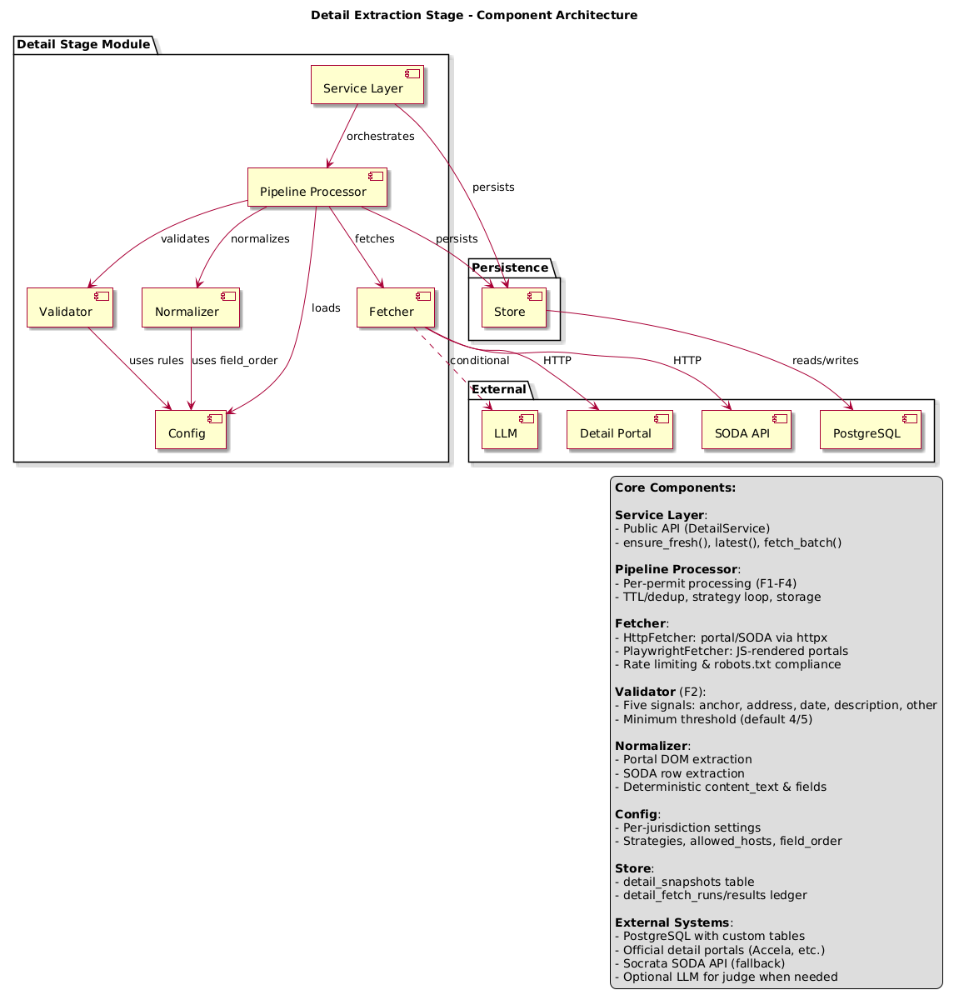
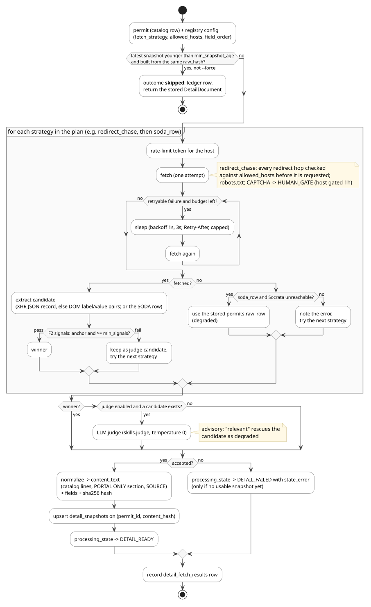

# Permit detail extraction (Stage 05)

For a permit, fetch its official detail record, check that the record belongs
to that permit, and store a citable snapshot. Stage 06 (skill inference) quotes
the snapshot's `content_text` as evidence; Stage 07 (orchestration) calls
`DetailService.ensure_fresh`.

Code: `src/permit_trade_skills/detail/` (no store imports), the SQL adapter
`src/permit_trade_skills/store/details.py`, the CLI `src/permit_trade_skills/cli/detail.py`.
Schema: `detail_snapshots` plus the run ledger `detail_fetch_runs` /
`detail_fetch_results` (migration `0004_detail_extraction`, see [schema.md](schema.md)).

### Component Architecture



Source: [diagrams/detail-component.puml](diagrams/detail-component.puml)

### Pipeline Flow



Source: [diagrams/detail-flow.puml](diagrams/detail-flow.puml)

## Quick start

```bash
uv run pts db migrate                 # 0004_detail_extraction
uv run pts seeds seattle              # writes the Seattle detail config into the registry
uv run pts detail fetch -p 7083363-CN
uv run pts detail show -p 7083363-CN
uv run pts detail fetch --status ISSUED --since 2026-06-01 --limit 25 --concurrency 3
uv run pts detail report --run <run_id>
```

| Command | What it does |
|---|---|
| `pts detail fetch -p N [-p N2 ...]` | Fetch one or more permits |
| `pts detail fetch --status S --since D [--until D] --limit N` | Fetch a cohort (newest issued first); `--since/--until` filter `issued_at` |
| `... --concurrency C` | Permits in parallel (default `detail.concurrency` = 3, max 8) |
| `... --force` | Re-fetch even when a fresh snapshot exists |
| `... --dry-run` | Print the plan (fetch or skip, strategies); no network, no writes |
| `... --resume RUN_ID` | Re-run a run's cohort, skipping permits already `ok`/`skipped` in it |
| `pts detail show -p N [--json]` | Latest snapshot: `content_text`, `fields`, provenance |
| `pts detail report --run RUN_ID [--json]` | Run summary: ok/failed/skipped, per strategy, per permit |
| `pts detail revalidate -p N` | Re-run extraction + F2 on the stored raw content (no network) |
| `pts detail pick-live [-n K]` | Most recently issued permit(s) with a detail URL, via the query API |

`-j/--jurisdiction` defaults to `seattle-kingcounty-wa`. `fetch` exits 1 when
every permit failed.

## Worked examples

The examples below ran against the Seattle database on 2026-11-06, except the
mixed-outcome report in example 4. Run ids, hashes and timestamps will differ
on your machine.

### 1. Find a permit to try: `pick-live`

```console
$ uv run pts detail pick-live -n 3
7156545-CN
7162510-CN
7152387-CN
```

This prints the most recently issued `ISSUED` permits that have a detail URL,
using the query API (the same as `GET /api/v1/permits?status=ISSUED&sort=issued_at_desc`).

### 2. Fetch one permit (and see the TTL skip)

The first fetch goes to the portal:

```console
$ uv run pts detail fetch -p 7083363-CN
Run detail-20261106T182747-0b0b98 (seattle-kingcounty-wa, completed): 1 ok, 0 failed, 0 skipped (0 degraded, 1 new snapshots)
  redirect_chase  ok=1
  7083363-CN     ok       redirect_chase  5db5fd4235d3
```

Fetching again within 24 hours, with the catalog row unchanged, is a no-op.
`skipped` returns the stored snapshot and makes no network request:

```console
$ uv run pts detail fetch -p 7083363-CN
Run detail-20261106T190541-6bad21 (seattle-kingcounty-wa, completed): 0 ok, 0 failed, 1 skipped (0 degraded, 0 new snapshots)
  redirect_chase  skipped=1
  7083363-CN     skipped  redirect_chase  08579a56ac63
```

`--force` re-fetches anyway, and `-p` can be repeated. When the content hasn't
changed, the hash is the same and the existing snapshot is refreshed instead of
duplicated (`0 new snapshots`):

```console
$ uv run pts detail fetch -p 7083363-CN -p 7152387-CN --force
Run detail-20261106T190544-245688 (seattle-kingcounty-wa, completed): 2 ok, 0 failed, 0 skipped (0 degraded, 0 new snapshots)
  redirect_chase  ok=2
  7152387-CN     ok       redirect_chase  747402edcfb5
  7083363-CN     ok       redirect_chase  08579a56ac63
```

The columns are permit, outcome, winning strategy and the first 12 characters
of the content hash.

### 3. Plan, then run, a batch

`--dry-run` shows what would happen for each permit, and the strategy order.
It makes no requests and no writes. This was captured after the batch below
had run, so every permit already has a fresh snapshot. Permits without one
show `fetch`.

```console
$ uv run pts detail fetch --status ISSUED --since 2026-06-01 --limit 5 --dry-run
Dry run: 5 permit(s) in seattle-kingcounty-wa
  7156545-CN     skip (fresh snapshot)  redirect_chase -> soda_row
  7162510-CN     skip (fresh snapshot)  redirect_chase -> soda_row
  7152387-CN     skip (fresh snapshot)  redirect_chase -> soda_row
  7163707-CN     skip (fresh snapshot)  redirect_chase -> soda_row
  7156276-DM     skip (fresh snapshot)  redirect_chase -> soda_row
```

Then run it:

```console
$ uv run pts detail fetch --status ISSUED --since 2026-06-01 --limit 5 --concurrency 3
Run detail-20261106T182830-2e1d57 (seattle-kingcounty-wa, completed): 5 ok, 0 failed, 0 skipped (0 degraded, 5 new snapshots)
  redirect_chase  ok=5
  7156545-CN     ok       redirect_chase  93e1969184b9
  7162510-CN     ok       redirect_chase  a4ad123efd35
  7152387-CN     ok       redirect_chase  747402edcfb5
  7163707-CN     ok       redirect_chase  180dd90fd3ab
  7156276-DM     ok       redirect_chase  817c88478505
```

This took 55 s. Seattle's portal is limited to 5 requests/min (one every 12 s),
so `--concurrency` mostly overlaps the waiting. Cohorts are taken newest-issued
first; `--since/--until` filter `issued_at`.

### 4. Read a run report: `report`

Any run can be reported again later by its id:

```console
$ uv run pts detail report --run detail-20261106T182830-2e1d57
Run detail-20261106T182830-2e1d57 (seattle-kingcounty-wa, completed): 5 ok, 0 failed, 0 skipped (0 degraded, 5 new snapshots)
  redirect_chase  ok=5
  7156545-CN     ok       redirect_chase  93e1969184b9
  ...
```

The next report shows a run with failures and a fallback. It comes from the
offline test scenario (`ScriptedFetcher`), not the live portal, but the format
is identical:
- one permit's portal timed out (retried twice) and the Socrata row won;
- one permit's redirect left the allow-list, and it has no Socrata row.

```console
Run detail-20261106T191500-a1b2c3 (seattle-kingcounty-wa, completed): 3 ok, 1 failed, 0 skipped (1 degraded, 3 new snapshots)
  none            failed=1
  redirect_chase  ok=2
  soda_row        ok=1
  errors: REDIRECT_BLOCKED=1
  7100004-CN     ok       redirect_chase  b7502dac6a74
  7100003-CN     ok       redirect_chase  28ec5a5cfa09
  7100002-CN     ok       soda_row        f442682a821d [degraded]
  7100001-CN     failed   REDIRECT_BLOCKED (retryable=False)
```

- `none` is the strategy bucket for permits where no strategy won.
- `[degraded]` marks a fallback win.
- Failed permits are left in `DETAIL_FAILED` with the error in `permits.state_error`.

`--json` returns the full report: `params`, `started_at`/`completed_at`,
`by_strategy`, `errors`, and per permit `attempts[]` (strategy, URL, HTTP
status, tries, signals, error). Use it to see *why* a permit fell back or failed:

```console
$ uv run pts detail report --run detail-20261106T182830-2e1d57 --json | jq '.results[0]'
```

### 5. Re-run a batch after fixing a problem: `--resume`

```console
$ uv run pts detail fetch --resume <run_id>
```

This reuses the run's stored cohort parameters and fetches only the permits
that are not already `ok`/`skipped` in that run. In the example 4 run, that
would be just `7100001-CN`. It records their new results under the same run id
(see `test_resume_skips_completed_permits`).

### 6. Look at what was stored: `show`

```console
$ uv run pts detail show -p 7083363-CN
Snapshot 2 | redirect_chase | fetched 2026-11-06 19:06Z | signals 5/4
Source:  https://services.seattle.gov/Portal/cap/CapDetail.aspx?type=1000&fromACA=Y&agencyCode=SEATTLE&Module=DPDPermits&capID1=25SCI&capID2=00000&capID3=45424
Hash:    08579a56ac638c6e9c71662eddee114c4c504005bffa956ac794190025c2743a
--- content_text ---
PERMIT: 7083363-CN
STATUS: Issued
ADDRESS: 3010 E CHERRY ST
CITY: SEATTLE
STATE: WA
ZIP: 98122
ISSUED: 2026-01-15T00:00:00.000
APPLIED: 2025-11-03T00:00:00.000
EXPIRES: 2027-07-15T00:00:00.000
DESCRIPTION: Construct alterations to the basement of an existing one family dwelling per plan.
CLASSIFICATION: Single Family/Duplex
...
PORTAL ONLY:
Action Type: Add/Alt
Application Completed Date: 11/03/2025
...
Other Type of Sprinkler System: smoke detectors, carbon monoxide detectors
Project Description: Basement remodel Construct alterations to the basement of an existing one family dwelling, per plan.
...
SOURCE: https://services.seattle.gov/Portal/cap/CapDetail.aspx?...
--- fields ---
{ "portal": {...}, "catalog": {...}, "attachments": [], "portal_source": "dom" }
```

- The header line gives the snapshot id, winning strategy, fetch time,
  `DEGRADED` when applicable, and the F2 score.
- `Note:` lines appear for fallbacks and judge verdicts.
- `--json` prints the exact `DetailDocument` that Stage 06 receives (here trimmed):

```console
$ uv run pts detail show -p 7083363-CN --json
{
  "permit_number": "7083363-CN",
  "jurisdiction": "seattle-kingcounty-wa",
  "snapshot_id": 2,
  "final_url": "https://services.seattle.gov/Portal/cap/CapDetail.aspx?...&capID3=45424",
  "content_text": "PERMIT: 7083363-CN\nSTATUS: Issued\nADDRES...",
  "fields": {
    "portal": {"scope": "Add/Alt", "status": "Issued", "address": "3010 E CHERRY ST 140981 *", "...": "..."},
    "catalog": {"zip": "98122", "city": "SEATTLE", "state": "WA", "...": "..."},
    "attachments": [],
    "portal_pairs": [["Action Type", "Add/Alt"], ["Application Completed Date", "11/03/2025"], "..."],
    "portal_source": "dom"
  },
  "fetch_strategy": "redirect_chase",
  "fetched_at": "2026-11-06T19:06:01.513338Z",
  "content_hash": "08579a56ac638c6e9c71662eddee114c4c504005bffa956ac794190025c2743a",
  "degraded": false,
  "notes": [],
  "signals": {"count": 5, "min_signals": 4, "anchor": true, "passed": true,
              "matched": {"anchor": true, "address": true, "date": true, "description": true, "other": true},
              "details": {"anchor": "record number field '7083363-CN'", "address_overlap": 1.0,
                          "description": {"shared": 7, "jaccard": 0.875}}}
}
```

A permit with no snapshot yet exits 1 with
`No detail snapshot for <N> in <jurisdiction> (run pts detail fetch -p <N>)`.

### 7. Re-check stored content offline: `revalidate`

After you change the registry config (e.g. `portal.include` or
`field_labels`), or when you suspect a snapshot, re-run extraction and F2 on
the stored raw HTML. Nothing is fetched or written:

```console
$ uv run pts detail revalidate -p 7083363-CN
{
  "permit_number": "7083363-CN",
  "snapshot_id": 2,
  "fetch_strategy": "redirect_chase",
  "stored_hash": "08579a56ac638c6e9c71662eddee114c4c504005bffa956ac794190025c2743a",
  "revalidated": true,
  "signals": {"count": 5, "min_signals": 4, "anchor": true, "passed": true, "...": "..."},
  "content_hash_now": "08579a56ac638c6e9c71662eddee114c4c504005bffa956ac794190025c2743a",
  "hash_matches": true,
  "missing_citations": []
}
```

How to read the result:
- `hash_matches: false` means the current config would render different text.
  Re-fetch with `--force` to store it.
- A non-empty `missing_citations` lists catalog values (number, address,
  description, issued date) absent from `content_text`. That breaks the Stage 06
  citation contract.
- The command exits 1 if the stored content no longer passes F2.
- After 90 days `raw_html` is pruned, and you get `"revalidated": false` with
  the reason.

### 8. Common mistakes

```console
$ uv run pts detail fetch -j seattle-kingcounty-wa
Give --permit, or a cohort with --status and/or --since        # exit 2

$ uv run pts detail fetch -p 0000000-XX
Not found in seattle-kingcounty-wa: 0000000-XX                 # exit 1 (not synced, or a typo)
```

## Strategies

A jurisdiction's registry config names a plan (`fetch_strategy`). The
strategies in the plan are tried in order, and the first whose content passes
validation wins. The stored `detail_snapshots.fetch_strategy` is the winning
strategy.

| Strategy | Use it when | How it fetches | Content |
|---|---|---|---|
| `redirect_chase` | The portal page is server-rendered (Seattle's Accela portal) | httpx; redirects followed one hop at a time, each hop's host checked against `allowed_hosts` before it is requested; robots.txt; a fresh cookie jar per fetch | Catalog row + `PORTAL ONLY` label/value pairs from the page |
| `playwright` | The portal renders with JavaScript or loads the record over XHR | Headless Chromium (lazy import; needs `uv run playwright install chromium`); off-allow-list requests aborted; XHR/fetch JSON bodies captured | Same, preferring a captured JSON record over the DOM |
| `soda_row` | Always available for a Socrata dataset; the deterministic fallback | `GET {soda_resource_url}?$where={key}='{escaped}'&$limit=1` | The SODA row only |

| Plan (`fetch_strategy`) | Strategies |
|---|---|
| `soda_row` (default when the registry has no `detail` block) | soda_row |
| `redirect_chase` | redirect_chase |
| `playwright` | playwright |
| `redirect_chase_then_soda` (**Seattle**) | redirect_chase, soda_row |
| `playwright_then_soda` | playwright, soda_row |
| `redirect_chase_then_playwright_then_soda` | redirect_chase, playwright, soda_row |

**Seattle.** `LinkToRecord.aspx?altId=<PERMITNUM>` returns 302 to
`Portal/urlrouting.ashx`, which returns 302 to `Portal/cap/CapDetail.aspx` on
the same host. The page is server-rendered, so plain HTTP gets the whole record
and no browser is needed. Extraction reads the record header (`.rec-left`) and
the Record Details tab (`#tab-record_detail`): work location, project
description, and the "More Details" Q&A (building code, occupancy, fire
protection, energy, housing units, valuation). The Inspections, Fees and
Attachments tabs load through ASP.NET postbacks. Postbacks are form
submissions, which this stage does not make, so those tabs are not captured.

**Degraded.** A snapshot is `degraded = true` when a fallback strategy won, when
soda_row used the stored row (below), or when the LLM judge accepted content
the signals rejected.

**Socrata unreachable.** If the soda_row request fails with a retryable error
(network, 429, 5xx), the snapshot is built from the permit's stored
`permits.raw_row`. This is the same source row, so the citation contract holds.
The snapshot is marked degraded with the note `Socrata unavailable ...; used the
stored catalog row`.

## Validation (F2 signals)

Fetched content is scored against the catalog permit. It passes when the
**anchor** holds and at least `min_signals` (default 4) of these five signals
match:

| Signal | Matches when |
|---|---|
| anchor (required) | A mapped record-number field equals the permit number (punctuation and case ignored). Without such a field, the number appears in the text. |
| address | At least 80% of the catalog address tokens appear in the candidate address field (or, without one, the text) |
| date | A date in the text (ISO or MM/DD/YYYY) is within ±1 day of a catalog date (issued, applied, completed or expires) |
| description | The candidate description or scope shares at least 4 content words (length > 3, not a stopword) with the catalog description, with Jaccard ≥ 0.3 |
| other | A status, valuation, trades, classification, scope or inspection field or token is present |

The anchor is mandatory, so a portal page for a different permit fails even
when the other four signals match (`tests/fixtures/portals/wrong_permit.html`).

**LLM judge** (optional, off by default). With `detail.judge_enabled: true` in
`config/settings.yaml`, when no strategy passes but some content was fetched,
the best candidate goes to the `skills.judge` role at temperature 0. The judge
returns strict JSON `{verdict: relevant|irrelevant|partial, reason}`. Only
`relevant` accepts the candidate (degraded, with a note). The judge never
overrides a signals pass. Page text is sent inside `<page>` delimiters as
untrusted data.

## Snapshot format and the citation contract (to Stage 06)

`content_text` is deterministic: the same inputs always give the same text and
the same `content_hash = sha256(content_text)`.

```
PERMIT: 7083363-CN                       <- catalog section: the SODA row, verbatim
STATUS: Issued                              (registry field_order first, then the
ADDRESS: 3010 E CHERRY ST                    remaining columns A-Z; nested objects as
...                                          COLUMN.KEY; whitespace collapsed)
ISSUED: 2026-01-15T00:00:00.000
DESCRIPTION: Construct alterations to the basement of an existing one family dwelling per plan.
...
PORTAL ONLY:                             <- portal strategies only, sorted
Floor Area (square feet): 916
Other Type of Sprinkler System: smoke detectors, carbon monoxide detectors
Project Description: Basement remodel Construct alterations to the basement of an existing one family dwelling, per plan.
...
SOURCE: https://services.seattle.gov/Portal/cap/CapDetail.aspx?...   <- final URL
```

- **Catalog section.** For every strategy it comes from the SODA row: the live
  row for `soda_row`, and the stored `permits.raw_row` for portal strategies.
  So `permit_number`, `address`, `description` and the issued date always
  appear verbatim (case-insensitive, whitespace-normalized). `missing_citations()`
  in `detail/signals.py` checks this, and it is the property the Stage 08
  faithfulness checker relies on.
- **PORTAL ONLY section.** Holds every label/value pair from the page, except
  pairs that repeat a catalog field with the same value (e.g. `Record Status:
  Issued`). These pairs are the reason to fetch the portal at all. Values are
  copied from the page, with only whitespace collapsed.
- **Evidence for Stage 06.** An `evidence` quote must be a substring of the
  stored `content_text` after whitespace collapsing and case folding;
  `evidence_source` is the snapshot's `final_url`.

`fields` (jsonb) holds the structured data:

| Key | Content |
|---|---|
| `catalog` | Canonical keys (`permit_number`, `status`, `address`, `description`, `issued_date`, `valuation`, ...) from the row, via `jurisdictions.field_map` |
| `portal` | Canonical keys mapped from portal labels (registry `portal.field_labels` plus built-in defaults) or JSON keys |
| `portal_pairs` | Every `[label, value]` pair from the page, sorted |
| `attachments` | Links that look like documents (raw `href`s, recorded as data, never downloaded) |
| `portal_source` | `dom` or `json` (a captured XHR record was used) |

## DetailService API (for Stages 06 and 07)

```python
from permit_trade_skills.wiring import detail_service

svc = detail_service()                       # SQL store + production fetchers
doc = svc.ensure_fresh("7083363-CN", "seattle-kingcounty-wa")   # DetailDocument
doc = svc.latest("7083363-CN", "seattle-kingcounty-wa")         # stored only, or None
```

`DetailDocument.to_dict()` has exactly these keys (pinned by
`tests/integration/test_detail_contract.py`): `permit_number, jurisdiction,
snapshot_id, final_url, content_text, fields, fetch_strategy, fetched_at,
content_hash, degraded, notes, signals`.

- `ensure_fresh(permit_number, jurisdiction, max_age=None, *, force=False)`
  returns the stored snapshot when it is younger than `max_age` (default
  `detail.min_snapshot_age_hours` = 24) **and** was built from the current
  `permits.raw_hash`. Otherwise it fetches. If a refresh fails but an older
  snapshot exists, that snapshot comes back with `degraded=True` and a
  `refresh failed (...)` note. If there is no snapshot at all, it raises
  `DetailUnavailable(error, retryable)`. Use `aensure_fresh` inside an event loop.
- `latest(...)` reads only (an in-process LRU of 512 entries, then the DB).
- Every `ensure_fresh` call writes a `detail_fetch_runs` row with
  `trigger='service'`.

Later stages must not import `permit_trade_skills.store` (enforced by
`tests/unit/test_import_boundary.py`). Get a wired service from
`permit_trade_skills.wiring`.

## Resilience and policy

| Setting (`config/settings.yaml` → `detail`) | Default | Meaning |
|---|---|---|
| `nav_timeout_s` | 20 | Per HTTP request / page navigation |
| `settle_timeout_s` | 8 | Playwright network-idle wait |
| `total_budget_s` | 60 | Per permit, all strategies and retries |
| `retries`, `backoff_s` | 2, [1, 3] | Retries per strategy after the first attempt |
| `max_retry_after_s` | 30 | Cap on an honoured `Retry-After` |
| `rate_limit_per_minute` | 20 | Per host, unless the registry sets one |
| `human_gate_cooldown_s` | 3600 | After a CAPTCHA, the host is skipped for this long (in the process) |
| `min_snapshot_age_hours` | 24 | Skip a re-fetch of an unchanged permit younger than this |
| `concurrency`, `max_concurrency` | 3, 8 | Batch parallelism |
| `judge_enabled` | false | LLM relevance judge |
| `user_agent` | `PermitTradeSkills/0.1 (...)` | Sent on every request |

Rate limits count one token per top-level fetch (a portal navigation including
its redirects, or one SODA request), with a burst of 1. Seattle's portal is
limited to 5/min (12 s apart) and its Socrata host to 20/min.

| Error | Retryable | Cause |
|---|---|---|
| `REDIRECT_BLOCKED` | no | The start URL or a redirect leaves `allowed_hosts`; the target is never requested |
| `HUMAN_GATE` | no | CAPTCHA or bot challenge; the host is gated for `human_gate_cooldown_s` |
| `HUMAN_GATE_ACTIVE` | yes | Skipped: the host is cooling down |
| `ROBOTS_DISALLOWED` | no | robots.txt disallows the path |
| `HTTP_ERROR` | no | 403, 404 and other 4xx |
| `HTTP_RETRYABLE` | yes | 408/425/429/5xx after retries |
| `TIMEOUT`, `NETWORK` | yes | Transport failures (also any exception a fetcher raises) |
| `BUDGET_EXCEEDED` | yes | The per-permit budget ran out |
| `NOT_FOUND` | no | No SODA row for the permit |
| `VALIDATION_FAILED` | no | Fetched, but F2 failed (and the judge did not accept it) |
| `NO_DETAIL_URL`, `NO_SODA_ENDPOINT` | no | The strategy has nothing to fetch |
| `BROWSER_UNAVAILABLE` | no | The playwright package or Chromium is missing |

A failed permit's error is the first failing strategy's error. It is retryable
if any attempt was retryable.

**Processing state.** On success the permit moves to `DETAIL_READY` (from
`SYNCED`, `DETAIL_FAILED` or `DETAIL_READY`). On failure it moves to
`DETAIL_FAILED`, with `state_error = {stage, error, retryable, attempts}`, but
only from `SYNCED` or `DETAIL_FAILED`. A permit that already has a usable
snapshot keeps its state. Permits in later states (`SKILLS_*`) keep their state
when re-fetched.

**Dedup.** Snapshots are unique per `(permit_id, content_hash)`. Re-fetching
identical content refreshes that row (`fetched_at`, provenance). Changed
content (e.g. a status change) inserts a new row, so the history is kept.

**Failure isolation.** One permit's failure, a fetcher exception, or a failed
ledger write never stops a batch. Every permit ends as `ok`, `failed` or
`skipped` in `detail_fetch_results`.

## Allow-list, ToS and safety

- Portal fetches go only to the registry's `allowed_hosts` (default: the
  detail URL's own host). Every redirect hop is checked **before** it is
  requested. A cross-origin redirect fails with `REDIRECT_BLOCKED`, and the
  blocked URL is logged. Playwright aborts every off-allow-list sub-request.
- Read-only public-record lookups: no credentials, no form submission or
  postbacks, no clicks, no `page.evaluate`, no CAPTCHA solving. Cookies live
  only for one fetch.
- robots.txt is fetched once per host per process and respected. A 4xx,
  redirect or non-text answer means no rules. Seattle's portal redirects
  `/robots.txt` to its home page, so it has no rules. A 5xx or network failure
  disallows the host for the process (RFC 9309). SODA API requests are
  programmatic API use and are not checked against robots.txt.
- Page content is untrusted data. It is never executed by this stage. The judge
  prompt quotes it inside delimiters and tells the model to ignore instructions
  in it.
- An honest `User-Agent` (`detail.user_agent`) is sent on every request.
- Attached plans are never downloaded; their links are recorded in
  `fields.attachments`.

## Adding a jurisdiction

Everything is registry configuration (`jurisdictions.detail_strategy.detail`).
No code changes are needed.

**Minimal (Socrata row only).** A registered Socrata jurisdiction with no
`detail` block already works: the plan defaults to `soda_row`, the endpoint is
`{base_url}/resource/{dataset_id}.json`, and the key column is
`field_map.permit_num`. To make it explicit:

```yaml
detail_strategy:
  detail:
    fetch_strategy: soda_row
    soda_key_column: permit_no            # the dataset's permit-number column
    field_order: [[PERMIT, permit_no], [STATUS, current_status], [ADDRESS, address],
                  [ISSUED, issue_date], [DESCRIPTION, work_description]]
```

Then:

1. Register it (`pts discovery register ...` or a seed) and sync it (`pts sync`).
2. `pts detail fetch -j <slug> -p <a permit number>`, then `pts detail show ...`:
   check the `PERMIT/ADDRESS/ISSUED/DESCRIPTION` lines and `signals 5/4`.
3. `pts detail fetch -j <slug> --status ISSUED --since <date> --limit 10`, then
   `pts detail report --run ...`.

**With a portal.** Open a detail URL in a browser.

- If the record is in the page source (View Source shows the values), use
  `redirect_chase_then_soda`.
- If it only appears after scripts run, use `playwright_then_soda` and install
  Chromium where the batch runs (`uv run playwright install chromium`).

Then add:

```yaml
    allowed_hosts: [permits.example.gov]        # every host the redirects pass through
    rate_limits_per_minute: {permits.example.gov: 5}
    portal:
      include: ["#record", ".permit-details"]   # DOM regions holding the record (#id, .class, tag)
      field_labels: {"Permit #": permit_number, "Job Address": address, "Scope": description}
```

Check with `pts detail fetch -p ... --force` and `pts detail show`. The
`PORTAL ONLY` lines should be the record's facts, not menus or boilerplate. If
they aren't, narrow `include`. `pts detail revalidate -p ...` re-checks stored
content after config changes without refetching.

## Tests and evidence

- `tests/unit/test_normalize.py`: determinism (shuffled DOM, reordered JSON
  keys), field extraction, the `PORTAL ONLY` section, hash stability, the
  zero-hallucination check (AC3).
- `tests/unit/test_f2_signals.py`: signal thresholds, wrong-permit anchor
  failure.
- `tests/unit/test_detail_fetchers.py`: `HttpFetcher` over `httpx.MockTransport`
  (redirects, bad-host block, 403, 429/Retry-After, CAPTCHA, robots), the
  Playwright fallback without a browser, the rate limiter.
- `tests/integration/test_strategies.py` and `test_detail_contract.py`: the
  pipeline on the test database with `ScriptedFetcher`. Covers fall-through,
  soda_row consistency, CAPTCHA stop, bad-host block, retry budget, TTL and new
  snapshots, the 10-permit batch, resume, the judge and the service contract.
- Fixtures: `tests/fixtures/portals/` (SSR, XHR, JS-rendered, SODA row,
  CAPTCHA, 403, bad-host redirect, wrong permit).
- No test needs a browser or the network. The live E2E is opt-in:
  `PTS_DETAIL_LIVE=1 uv run pytest tests/integration/test_detail_live.py -s`
  (nightly CI job `detail-live`). It writes
  `evals/evidence/seattle/detail/<date>-<permit>.json`.

**Measured (2026-11-06, live Seattle).**

- Single permit (`7083363-CN`): `redirect_chase` in about 1.5 s, 5/5 signals,
  65 portal label/value pairs.
- Batch of 5 recently issued permits: 5 ok via `redirect_chase` in 55 s (the
  5/min portal rate limit dominates).
- `soda_row` against `cos-data.seattle.gov`: ok, 5/5 signals.
- Live E2E: `7170445-CN`, `redirect_chase`, 5/5 signals.
