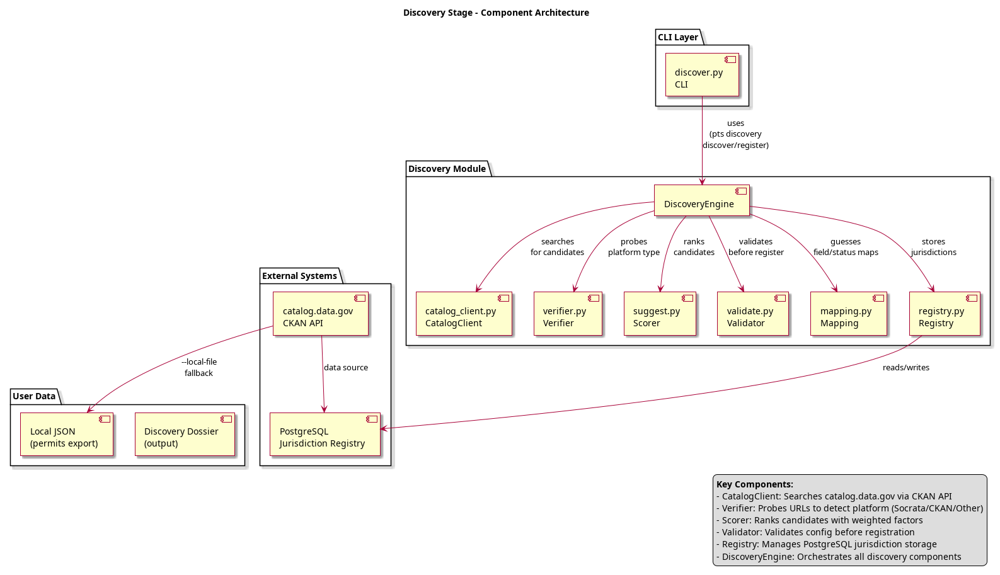

# Adding a jurisdiction (discovery runbook)

How to register a new city or county with the CLI only, from catalog.data.gov
or from a downloaded export, and get its permits into the store. Command options are in
[how-to-guide.md](how-to-guide.md); sync is in [ingest-how-to-guide.md](ingest-how-to-guide.md).

The steps below are the ones `tests/integration/test_discovery_stage01.py::test_second_mock_jurisdiction_end_to_end`
runs against a mock jurisdiction (`tests/fixtures/discovery/mock_bellevue_permits.json`, made-up data).

## Architecture Overview

The discovery stage follows this component architecture:



*See [discovery-component.puml](diagrams/discovery-component.puml) for the PlantUML source.*

The **Discovery Module** coordinates:

- **CatalogClient**: Searches catalog.data.gov via CKAN API for permit datasets
- **Verifier**: Probes URLs to detect platform (Socrata/CKAN/Other)
- **Scorer**: Ranks candidates using weighted factors (title 35%, org 20%, keywords 20%, platform 15%, metadata 10%)
- **Validator**: Checks field maps, status maps, and detail strategies before registration
- **Registry**: Manages PostgreSQL storage of jurisdiction configurations
- **DiscoveryEngine**: Orchestrates all components

The **CLI Layer** (`pts discovery discover/register`) provides the command interface.

The **External Systems** (catalog.data.gov, PostgreSQL) are the data sources and storage.

The **User Data** folders contain local exports and generated dossiers.

## 1. Discover

From catalog.data.gov:

```bash
uv run pts discovery discover -j "Bellevue" -s WA -o bellevue.json
uv run pts discovery discover -j "Bellevue" -s WA -q '"building permits" Bellevue' --limit 25 -o bellevue.json
```

From an export of the city's permit dataset (a JSON array of rows, e.g. a
Socrata `rows.json` download), when the catalog is unavailable or to get the
maps guessed:

```bash
uv run pts discovery discover -j "Bellevue" -s WA --local-file bellevue-permits.json -o bellevue.json
```

What you get:

- A ranked table of candidates: score, platform, id, title, and the top
  candidate's score breakdown (title 35 %, organization 20 %, keywords 20 %,
  platform 15 %, metadata 10 %).
- The dossier at `-o` (candidates, probe results, `field_mapping`,
  `status_mapping`, `detail_strategy`, `notes`, `discovery_run_id`).
- A row in `discovery_runs` (not linked to a jurisdiction until you register).
- An audit copy at `evals/evidence/<jurisdiction-id>/discovery/<date>-<run>.json`
  (`--evidence-dir` to change it); candidates' raw catalog metadata is left out.

The jurisdiction id is `<name>-<state>` lower-cased (e.g. `bellevue-wa`).

## 2. Review the dossier

- **Catalog dossiers have empty maps.** The probes look only at the host, not
  the dataset's columns. Fill in `field_mapping` and `status_mapping` yourself
  (or run a `--local-file` discovery on an export of the chosen dataset).
- **Local-file dossiers have guessed maps.** Check them:
  - `field_mapping`: canonical field → source column, from a synonym table
    (`src/permit_trade_skills/discovery/mapping.py`).
  - `status_mapping`: canonical status → raw values, from keyword rules. Raw
    values no rule matched are listed in `notes`; add them by hand or they sync
    as `UNKNOWN`.
- Optionally add to `detail_strategy`:
  - `timestamp_field`: the source column for incremental Socrata syncs
    (without it every Socrata sync pulls everything);
  - `detail_url_rule`: a URL with `{{column}}` placeholders, for rows without a
    link column.

## 3. Check, then register

```bash
uv run pts discovery register -d bellevue.json -n "Bellevue" -s WA -c "King County" --dry-run
uv run pts discovery register -d bellevue.json -n "Bellevue" -s WA -c "King County"
```

`--dry-run` prints the config that would be stored, the chosen candidate and
its score, the probes, the validation result and the action (`insert`,
`replace`, or `refused` with the reason); it writes nothing and exits 1 if the
real run would be refused.

Validation (`src/permit_trade_skills/discovery/validate.py`):

| Errors (block; `--force` overrides) | Warnings |
|---|---|
| no `permit_num` mapping (every row would be dropped) | field-map keys that aren't canonical fields |
| status-map keys that aren't canonical statuses | `status_current`, `description`, `issue_date`, `address` unmapped |
| status-map values that aren't lists of strings | empty status map |
| `detail_url_rule` placeholders that aren't mapped columns | a raw status under two keys |
| with `--check-columns`: mapped columns missing from the live `columns.json` | no / unmapped `timestamp_field` |

Other options:

- `--approve <candidate-id>` registers that candidate instead of the top one.
- `--replace` overwrites an existing jurisdiction with the same id. Without it,
  registering an existing id is refused. The replaced config is kept.
- `--check-columns` fetches `<base_url>/api/views/<dataset_id>/columns.json`.
  Jurisdictions registered from a dossier have no `base_url` yet (see Limits),
  so the check is skipped with a warning; `pts seeds seattle --check-columns`
  uses it for Seattle once its API is back.

Registering links the discovery run to the jurisdiction and saves the probes.

## 4. Sync and check

```bash
uv run pts sync sync -j bellevue-wa --local-file bellevue-permits.json
uv run pts sync sync-report -j bellevue-wa --last 1
uv run pts db doctor
```

Look at the `unknown_status` and `missing_detail_url` warnings; fix the maps and
register again with `--replace`.

## 5. Keep the config

```bash
uv run pts config export -j bellevue-wa                 # -> config/jurisdictions/bellevue-wa.yaml
uv run pts config history -j bellevue-wa                # versions, when and by what they were replaced
uv run pts config history -j bellevue-wa --version 1    # an old version as YAML
```

Each sync report records the `config_version` it used, so `pts config history`
recovers the exact config behind any past sync (for versions replaced after
migration `0006_jurisdiction_history`; earlier replacements were not kept).

## Limits

- **Socrata sync of a newly discovered jurisdiction.** A dossier registers
  `base_url = ""` and the CKAN package id as `dataset_id`, so `pts sync sync`
  without `--local-file` refuses it ("no base_url/dataset_id"). Until the
  dataset-level verifier (D2) fills these in, set them with SQL:
  `UPDATE jurisdictions SET base_url = 'https://data.example.gov', dataset_id = 'abcd-1234' WHERE id = '...';`
- **No-API (HTML/PDF-only) jurisdictions.** There is no `machine_readable` flag
  yet; such a city can only be synced from an export with `--local-file`, and
  the detail stage needs its own config (`docs/detail.md`).
- **Probes are host-level.** Any `.gov` host is classified Socrata; nothing
  checks that the dataset has permit columns.
- **Slugs are not enforced.** Discovery derives `<name>-<state>`; the seed
  uses `<city>-<county>-<state>` (`seattle-kingcounty-wa`).
