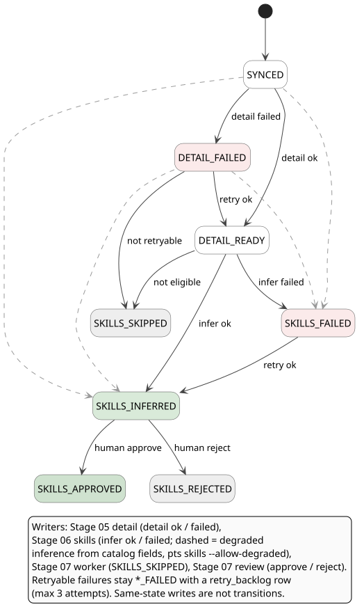

# Orchestration: planner agent, pipeline worker, human review

Stage 07 makes the system agentic. It has three parts, all in
`src/permit_trade_skills/orchestration/`:

- **Planner agent** (`pts agent goal`): answers a permit question end to end by
  calling a small, closed set of tools, and returns a cited report whose permits
  and skills are checked against what the tools actually returned.
- **Pipeline worker** (`pts pipeline run`): drives every eligible permit
  through detail extraction (Stage 05) and skill inference (Stage 06), with
  retries, concurrency, a time budget and an event trail, until each permit is
  inferred, skipped, or a reported failure.
- **Human review** (`pts review`): a person approves, rejects or flags each
  inference. The agent can only *propose*.

How to run and operate it day to day is in [ops.md](ops.md#orchestration-stage-07).

## Modules

| Module | Role |
|---|---|
| `tools.py` | `AgentTool`, the closed `toolset-v1` and `ToolExecutor` (the guardrails) |
| `planner.py` + `prompts/planner_v1.md` | The planner loop (role `agent.planner`) |
| `schemas.py` | The per-turn action schema and the `AgentReport` schema |
| `validator.py` | `validate_report`: the no-fabrication check |
| `budgets.py` | Hard planner budgets |
| `pipeline.py` | `PipelineWorker`: plan, run, status, cohort dashboard |
| `review.py` | `ReviewService`: the agent path (`propose`) and the human path (`decide`) |
| `states.py` | The lifecycle legal-edge table and `IllegalTransition` |
| `events.py` | The `orchestration_events` trail and run ids |
| `replay.py` | `pts agent replay`: re-run a recorded run read-only and diff |
| `costs.py` | `MeteredProvider`: LLM calls, tokens and cost for run reports |
| `ports.py` | The persistence Protocol; SQL adapter `store/orchestration.py` |

Like `detail/` and `skills/`, this package never imports the store. Wired
objects come from `permit_trade_skills.wiring` (`planner()`,
`pipeline_worker()`, `review_service()`, `agent_toolset()`). From Stage 06 it
imports only `permit_trade_skills.skills`. A grep test also keeps jurisdiction
names, ids and hosts out of its code and prompt.

## Architecture

**Figure 1**: High-level component diagram of the Agentic Orchestration stage. The
planner agent (left) uses a closed toolset to answer permit questions via an LLM-driven
next-action loop. The pipeline worker (center) drives every eligible permit through
detail extraction and skill inference with retries, concurrency, and state machine
enforcement. Human review (right) provides HITL gates where agents propose and humans
decide. All components interact with the orchestration store protocol for events,
durable queues, and review tracking.

## The planner agent

### Tools (`toolset-v1`)

| Tool | Wraps | Cost class | Notes |
|---|---|---|---|
| `search_permits` | Stage 04 query tool | free | filters, sort, paging |
| `get_permit` | Stage 04 query tool | free | includes detail-snapshot presence and the latest inference |
| `permit_status_counts` | Stage 04 query tool | free | |
| `list_jurisdictions` | Stage 04 query tool | free | |
| `ensure_detail` | `DetailService.ensure_fresh` | cheap | network, up to ~60 s |
| `get_detail` | `DetailService.latest` | free | stored only |
| `infer_trade_skills` | `SkillService.infer` | expensive_llm | one LLM call; a stored result for the same inputs costs none |
| `get_skill_inference` | `SkillService.latest` | free | stored only |
| `submit_review` | `ReviewService.propose` | free | not idempotent; only proposes |

Every tool returns `{ok, data}` or `{ok: false, error_code, message, retryable}`
and never raises. The planner writes nothing directly: its only writes go
through the Stage 05/06 services and the review proposal.

### The loop

The LLM abstraction is single-turn (`complete(system, user)`), so the planner
is a **JSON next-action loop**. Each turn sends the goal, the budget used so
far and the transcript of earlier calls. Results are compacted for the prompt
(search rows trimmed, a 4,000-character cap per result); the transcript itself
keeps them whole. The model returns one JSON action, either a tool call
(`tool` + `arguments_json`) or the final answer
(`findings`, `unfulfilled`, `confidence`, `citations`). The schema is OpenAI
strict-mode compatible and works the same with the local Ollama model.

Before the first turn, the jurisdiction is resolved with `list_jurisdictions`
(the only active one) unless `-j` names it. Tools that take a `jurisdiction`
default to it.

### Guardrails (in code, not just in the prompt)

| Guard | Behaviour |
|---|---|
| Arguments | Validated against the tool's JSON Schema before anything runs; else `INVALID_PARAMETER` |
| Retry | A retryable failure is retried once automatically |
| Branch | A tool + arguments that failed twice is refused (`BRANCH_ABANDONED`) |
| Not idempotent | A repeat of a successful `submit_review` with the same arguments is refused (`DUPLICATE_CALL`) |
| Tool calls ≤ 10, `expensive_llm` ≤ 4 | A call past the cap is refused (`BUDGET_EXHAUSTED`); the planner can still answer |
| Turns ≤ 12, wall clock ≤ 300 s | Hard stop: a partial report built by code from the transcript, `confidence: low`, the cause in `unfulfilled` |
| Planner model unavailable | Same hard stop (`planner_unavailable`) |

Budgets are `orchestration.agent` in `config/settings.yaml`.

### The report and the no-fabrication check

`AgentReport` = `run_id, goal, jurisdiction, toolset_version, prompt_version,
model, steps, findings, unfulfilled, confidence, citations, integrity,
violations, warnings, budget, llm, stopped`. `steps`, `integrity`, `budget` and
`llm` come from code, never from the model.

`validate_report(transcript, report)` runs on every goal at no LLM cost:

- **fabricated_permit**: a finding's permit was not returned by
  `search_permits` or `get_permit` in this run.
- **ungrounded_skill**: a finding's skill and evidence are not in an inference
  result for that permit.
- **unexplained_gap**: no findings and nothing in `unfulfilled`.

Any violation makes `integrity: FAILED`, adds an `agent.integrity_failed`
event, and `pts agent goal` exits 3. Citation problems (an index out of range,
or a `tool:<name>:<permit>` source with no matching call) are warnings.

### Replay

`pts agent replay --run <id>` re-runs every recorded tool call with its stored
arguments against current data. Read-only tools run as they are;
`ensure_detail` runs as `get_detail` and `infer_trade_skills` as
`get_skill_inference` (same result shape); `submit_review` and refused calls
are skipped. No LLM call, no network, no writes. Each call is reported as
identical, changed (with the changed keys, and per permit the changed fields
or the permits added or removed) or skipped. A replay right after a run
usually shows the run's own progress, for example a searched permit that is
now `SKILLS_INFERRED`.

## The pipeline worker

### Eligibility

One query per run. It selects permits of the jurisdiction whose `status` is in
`skills.allowed_statuses` (default `ISSUED`, the statuses Stage 06 accepts) and
whose `processing_state` is `SYNCED`, `DETAIL_READY`, `DETAIL_FAILED` or
`SKILLS_FAILED`, newest issued first. Options: `--limit` (default 25),
`--since` (issued on or after), and `--permit` (repeatable).

These are left out:

- permits whose retry is not due yet, or whose attempts are used up
  (`retry_backlog`); `--permit` ignores the backlog;
- `SKILLS_FAILED` permits whose failure is not retryable (`GROUNDING_FAILED`,
  `NO_SKILLS`). They stay `SKILLS_FAILED` and are reported.

### Per permit

| Start state | Steps | Outcomes |
|---|---|---|
| `SYNCED`, `DETAIL_FAILED` | detail, then infer | as below |
| `DETAIL_FAILED`, not retryable | none | `SKILLS_SKIPPED` (reason kept) |
| `DETAIL_READY`, `SKILLS_FAILED` | infer | as below |

- Detail ok → `DETAIL_READY` → infer ok → `SKILLS_INFERRED`.
- Detail failed, retryable → stays `DETAIL_FAILED`, retry booked.
- Detail failed, not retryable (`HUMAN_GATE`, `REDIRECT_BLOCKED`, `NOT_FOUND`, …)
  → `SKILLS_SKIPPED`.
- Infer failed, retryable (`PROVIDER_UNAVAILABLE`, `SCHEMA_INVALID`, timeout) →
  `SKILLS_FAILED`, retry booked.
- Infer failed, not retryable → `SKILLS_FAILED`, stable.
- Not eligible for inference → `SKILLS_SKIPPED`.

### State machine

Source: [diagrams/orchestration-states.puml](diagrams/orchestration-states.puml)

Three writers move a permit, each with its own compare-and-set: Stage 05
(detail), Stage 06 (skills), and Stage 07 (the worker's skips and the human
review). `states.EDGES` is the union of their edges. The worker checks its own
writes against it first (`IllegalTransition`, nothing written). It observes
the Stage 05/06 writes after each step and records each one as a `transition`
event; an edge outside the table would be flagged `ILLEGAL_TRANSITION` and fail
the CLI run. Same-state writes (a re-inference that keeps `SKILLS_INFERRED`, a
repeated failure) are not transitions.

### Retries

| Setting (`orchestration.pipeline`) | Default | Meaning |
|---|---|---|
| `attempts_per_run` | 2 | attempts of one step within a run |
| `max_attempts` | 3 | attempts in all; then the permit stays `*_FAILED` (exhausted) |
| `backoff_s` | `[30, 120]` | wait before attempt 2 and 3 |
| `detail_timeout_s`, `infer_timeout_s` | 120 | wall cap per attempt |

Attempt 1 fails → wait 30 s → attempt 2 in the same run. If that fails too, a
`retry_backlog` row sets `next_retry_at` = now + 2 min, and a later run makes
attempt 3. Stage 05 retries its own fetches inside each attempt (`detail.retries`).

### Durable queue, concurrency, stopping

`permits.processing_state` plus `retry_backlog` *are* the queue; there is no
job store. A stopped run leaves the rest for the next run. Nothing is
duplicated, because Stage 06 stores one inference per input cache key.

`--workers` (default 4, max 16) permits run at a time on one event loop.
Detail fetches share one Stage 05 pipeline, and so its per-host rate limits
and CAPTCHA cool-downs. Inference runs in threads.

- `--max-minutes` (default 60): stop scheduling; in-flight permits finish.
- SIGTERM / SIGINT: stop scheduling, give in-flight permits `drain_s` (30 s),
  then cancel them. They keep their state and are retried next run. An LLM
  call already in flight cannot be interrupted, so the process exits when it
  returns.

### Records

- `orchestration_events`: `pipeline.start`, `step.detail` / `step.infer` (one
  per attempt, with latency), `transition`, `retry.scheduled` /
  `retry.exhausted`, `permit.done`, `pipeline.finish`. Agent runs add
  `agent.start`, `tool.call`, `agent.finish`. Reviews add `review.decision`.
  Every event is also a JSON log line (logger `pts.orchestration`).
- `pipeline_runs`: one report row per run: status (`completed`, `stopped`,
  `failed`), planned / completed / failed / skipped / queued, `llm_calls`,
  `tokens`, `est_cost`.
- `detail_fetch_runs`: the Stage 05 ledger, under the pipeline's run id.

`--dry-run` (or `pts pipeline plan`) prints the plan with the at-most LLM call
count: no LLM, no network, no writes.

## Human review

| Command | Effect |
|---|---|
| `pts review list [--state] [--confidence] [--needs-human]` | Open inferences (`PENDING`, `NEEDS_HUMAN`) with confidence, skill / dropped / assumption counts, age |
| `pts review inspect -p …` | Skills with evidence and ✓/✗ grounding, assumptions, detail provenance, review fields |
| `pts review approve -p …` | `APPROVED` + `SKILLS_INFERRED → SKILLS_APPROVED` |
| `pts review reject -p … --note …` | `REJECTED` + `SKILLS_REJECTED`; the note is required |
| `pts review needs-human -p …` | `NEEDS_HUMAN`; the state does not change |
| `pts review approve --all --confidence high --yes` | Bulk approve: prints the exact list first; without `--yes` nothing changes |

The reviewer is `PTS_REVIEWER` (shell or `.env`); decisions store `reviewer`,
`reviewed_at` and `review_note`. They apply to the permit's latest inference,
and only while it is `PENDING` or `NEEDS_HUMAN`.

The agent path is separate. `submit_review` has no reviewer parameter, and
whatever the agent proposes is stored as `review_status = NEEDS_HUMAN`,
`proposed_by = 'agent'`, `proposed_decision = approve | reject | needs_human`.
The permit's state never changes. Tests check that the planner, tools and
worker never call the human path or read `PTS_REVIEWER`, and that only
`review.py` writes an approve/reject status.

## Measured (2026-11-10, local Ollama `qwen3.8:latest`)

- Live pipeline, 2 Seattle permits: both `SYNCED → SKILLS_INFERRED`, 2 LLM
  calls, 59 s.
- Live acceptance goal: "Seattle: permits ISSUED last 90 days, Residential,
  cost >= 25000 — top 5 by cost, and the trade skills for each". 10 turns,
  10 tool calls, 3 inferences. Integrity PASSED. 5 findings: 3 with cited skills, and
  the other 2 reported in `unfulfilled` because the tool-call budget ran out.
  With the default budgets, a "top 5 with skills" goal covers about 3 permits
  that have no stored inference yet.
- Evidence: `evals/evidence/seattle/orchestration/2026-11-10-live-demo.json`
  (the report, its replay, and the pipeline run).
