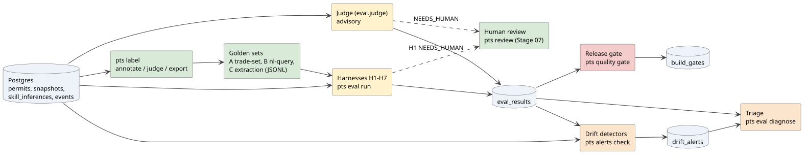
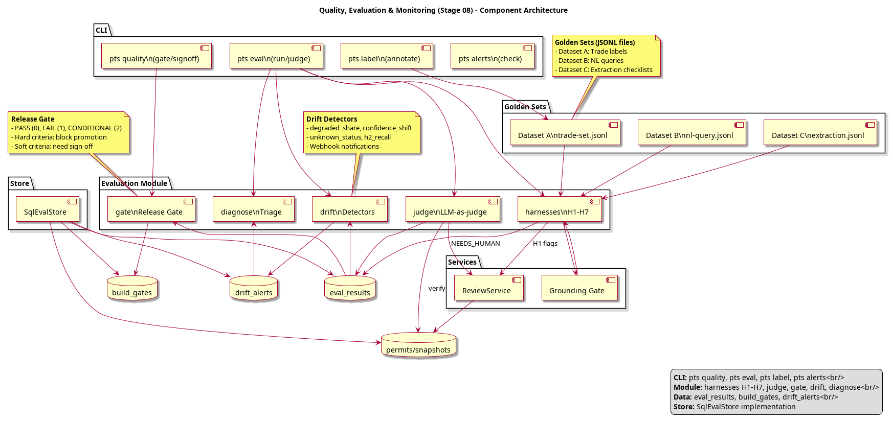

# Quality Definition

What "good" means for this system, how it is measured, and what blocks a
release. This page is the contract; the numbers live in
`config/settings.yaml` (`eval.thresholds`), never in code. Operating
procedures are in [quality_runbook.md](quality_runbook.md).

Source: [diagrams/quality-flow.puml](diagrams/quality-flow.puml)

---

## Component Architecture

The following diagram shows a simplified component architecture of the Quality, Evaluation & Monitoring layer:

Source: [diagrams/quality-component.puml](diagrams/quality-component.puml)

**Key components:**
- **CLI**: `pts quality`, `pts eval`, `pts label`, `pts alerts` commands
- **Evaluation Module**: Harnesses H1-H7, LLM-as-judge, release gate, drift detectors, and root-cause triage
- **Golden Sets**: Test data (Dataset A: trades, Dataset B: NL queries, Dataset C: extraction checklists)
- **Store**: `SqlEvalStore` implementing the `EvalStore` protocol
- **Data**: `eval_results`, `build_gates`, `drift_alerts` tables in PostgreSQL
- **Services**: `ReviewService` (human review) and `Grounding Gate` (citation verification)

## The two properties that matter most

The system lists the trade skills a permit requires, each cited to a quote
from the permit's detail page. Two failures hurt users:

1. **Unfaithful output**: a skill whose quote is not in the page, or does not
   support it ("Electrical" when the permit only mentions a smoke detector).
   Measured by H1 (string check, every accepted row) and the judge (meaning,
   on a sample).
2. **Missed work**: a trade the permit clearly needs is absent. Measured by H2
   recall against human labels. Recall is weighted above precision: missing a
   required trade is worse than listing one extra defensible trade.

## Metrics and thresholds

| Criterion | What is measured | Threshold | Gate |
|---|---|---|---|
| `H1.faithfulness` | Accepted `skill_inferences` rows whose every quote is verbatim in the **stored** detail text and cites its URL (re-checked independently of the writer) | 100% | **hard** |
| `H2.recall` | Mean recall@required on Dataset A, non-degraded rows: \|output ∩ required\| / \|required\| | ≥ 0.80 | soft |
| `H2.trap_hallucination_rate` | Precision traps (labelled "unrequired" trades) that the output claimed / all traps | ≤ 0.10 | soft |
| `H2.degraded_recall` | Recall on rows whose detail is degraded (catalog text only) | ≥ 0.50 | soft |
| `H3.full_match` | Dataset B questions whose parse matches every expected parameter and reports the expected unfulfilled filters | ≥ 0.90 | soft |
| `H4.must_appear` | Dataset C checklists + an automatic list (number, address, status) for the newest snapshots, found verbatim in `content_text` | ≥ 0.90 | soft |
| `H4.catalog_grounding` | `soda_row` snapshots that contain every catalog value of their row | 100% | **hard** |
| `H5.fabrications` | Agent findings citing a permit or skill that no tool returned in that run (stored runs re-validated) | 0 | **hard** |
| `H6.loss` | Source rows (export file or Socrata count) missing from the store | 0% | **hard** |
| `H7.violations` | Illegal state transitions + approve/reject decisions without a human | 0 | **hard** |

Reported, not gated: H2 precision, raw faithfulness before the grounding
gate, recall by difficulty and by confidence (calibration), H3 exact match
and row-count deviation, H4 fetch-strategy mix, the judge's scores and flags,
and the SLO (≥ 95% of ISSUED permits with an accepted inference within 24 h
of their first sync; P95 issued → approved-ready < 72 h).

## Hard vs soft

- **Hard** criteria are invariants of the write path or the data. A breach
  is a defect, not a model weakness: the gate **FAILs** and the build is not
  promoted. A hard criterion that was not measured for the build also fails.
- **Soft** criteria measure model quality. A breach (or a missing
  measurement) makes the gate **CONDITIONAL**: promotion needs an owner
  sign-off (`pts quality signoff`), stored with the gate report.
- The **judge** never gates and never rejects. It can only flag a row
  `NEEDS_HUMAN`; a human decides with `pts review`.

Exit codes of `pts quality gate`: 0 PASS, 1 FAIL, 2 CONDITIONAL.

## Golden sets

Under `evals/golden/<dataset dir>/` (Seattle: `evals/golden/seattle/`):

| Dataset | File | Content |
|---|---|---|
| A trade sets | `trade-set.jsonl` | Adjudicated labels for residential ISSUED/COMPLETED permits, each with its exact input (catalog fields + detail text) |
| B NL queries | `nl-query.jsonl` | Question, expected parameters, expected unfulfilled filters, gold row count at `as_of` |
| C extraction | `extraction.jsonl` | 3-5 lines that must appear verbatim in the permit's detail text |

Every row carries `labeled_by`, `label_version`, `labeled_at` and
`pinned_input_hash`. A row whose input no longer matches its hash is
SUPERSEDED and not scored (`pts label verify`). Labels are never overwritten.

### Trade vocabulary

Labels use these canonical trades (`eval/trades.py`); model output is mapped
onto them by pattern, and an unmapped trade counts against precision:

Carpentry, Concrete, Masonry, Drywall, Electrical, Plumbing, HVAC, Roofing,
Siding, Insulation, Painting, Windows/Doors, Fire Protection, Demolition,
Abatement, Excavation, Paving, Structural Steel, Flooring, Landscaping,
Elevator, General Construction.

### Labeling protocol

For each permit, read the whole detail text (`pts label show -p <permit> --full`):

- **required**: the scope (description, project description, or a detail
  answer such as "Heating Fuel Type Proposed: Electric Heat Pump") names the
  work, or the permit type cannot be done without it (a new dwelling needs
  framing, a foundation, electrical, plumbing, roofing). "Yes" answers count
  ("earth disturbance > 2,000 sq ft: Yes" → Excavation; "NFPA 13D" →
  Fire Protection).
- **optional**: defensible but not stated (drywall in a kitchen remodel).
- **unrequired (traps)**: trades a naive model might claim that the detail does
  not support or rules out ("HVAC mechanical system?: No", "foundation to remain").
- **difficulty**: easy (explicit scope), medium (implied by the permit type),
  hard (vague scope or catalog text only).

Two labelers label independently; an adjudicator (not one of them) writes the
gold row: the union of the required trades, minus any trade dropped with a
note. Disagreements and drops are stored.

## Where results go

`eval_results` (one row per item and metric, plus a summary per run),
`build_gates`, `drift_alerts`; live run reports under
`evals/evidence/<dataset dir>/eval/`. Prometheus gauges at `GET /metrics`
(`pts eval metrics` prints the same).
