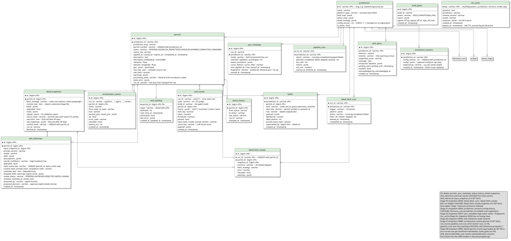
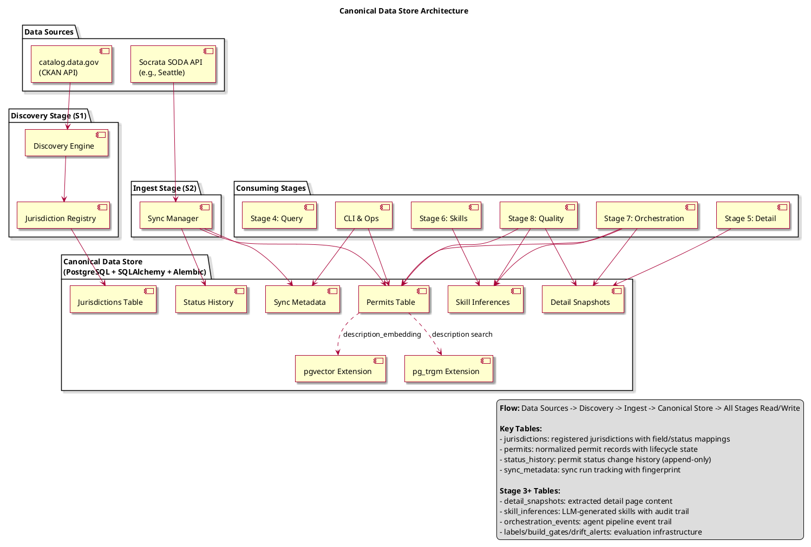

# Canonical store schema

The single PostgreSQL schema every stage reads and writes. Models:
`src/permit_trade_skills/discovery/registry.py`. Migrations:
`src/permit_trade_skills/db/migrations/versions/` (`0001_initial`,
`0002_canonical_store`, `0003_nlu_cache`, `0004_detail_extraction`,
`0005_skill_inference_audit`, `0006_jurisdiction_history`,
`0007_sync_fingerprint`, `0008_orchestration`, `0009_evaluation`). Data access: `src/permit_trade_skills/store/`. How to
change or operate the database is in [ops.md](ops.md).

Conventions:
- IDs are strings, and a jurisdiction's `id` is its slug.
- Timestamps are `timestamp` columns holding UTC.
- Extensions: `vector` (embeddings) and `pg_trgm` (keyword search).

## ER diagram



Source: [diagrams/schema-er.puml](diagrams/schema-er.puml) (PlantUML). After
editing it, re-render with
`java -jar /opt/plantuml/plantuml.jar -tsvg docs/diagrams/schema-er.puml`.

## High-Level Architecture



Source: [diagrams/schema-c4.puml](diagrams/schema-c4.puml) (PlantUML Component
Diagram). Shows the pipeline flow from Data Sources through the Canonical Data
Store to all consuming stages.

The diagram shows:
- **Pipeline flow**: Data Sources → Discovery → Ingest → Canonical Store → All Stages
- **Key tables**: jurisdictions, permits, status_history, sync_metadata
- **Stage 3+ tables**: detail_snapshots, skill_inferences
- **Extensions**: pgvector (embeddings), pg_trgm (trigram search)
- **Consuming stages**: Query, Detail, Skills, Orchestration, Quality, CLI & Ops

## Indexes on `permits`

| Index | Serves |
|---|---|
| `idx_permit_jurisdiction_number` UNIQUE `(jurisdiction_id, permit_number)` | upsert lookup, `get` by number |
| `idx_permits_slug_status_issued` `(jurisdiction_slug, status, issued_at DESC)` | hot path: status + recent issue date |
| `brin_permits_issued_at`, `brin_permits_applied_at` | wide date-range scans on time-ordered data |
| `idx_permits_slug_class` `(jurisdiction_slug, permit_class_mapped)` | class filters |
| `idx_permits_slug_zip` `(jurisdiction_slug, zip_code)` | ZIP filters |
| `gin_permits_description_trgm` GIN `(description gin_trgm_ops)` | `ILIKE '%keyword%'` |
| `gist_permits_geo` GiST `(geo)` | proximity on the generated point |

`permits` uses `FILLFACTOR=90`.

## Query cookbook

These are the six queries the product runs. The plans were captured on the
live Seattle data (193,249 permits) with
`EXPLAIN (ANALYZE, BUFFERS, COSTS OFF)`, trimmed.

### 1. Hot path: permits issued in the last 90 days

Used by `PermitRepository.list(PermitQuery(jurisdiction=..., status="ISSUED", issued_after=...))`.

```sql
SELECT id, permit_number, issued_at FROM permits
WHERE jurisdiction_slug = 'seattle-kingcounty-wa' AND status = 'ISSUED'
  AND issued_at >= (now() AT TIME ZONE 'utc') - interval '90 days'
ORDER BY issued_at DESC;
```
```
Index Scan using idx_permits_slug_status_issued on permits (actual time=0.039..2.366 rows=828 loops=1)
  Index Cond: ((jurisdiction_slug = 'seattle-kingcounty-wa') AND (status = 'ISSUED')
               AND (issued_at >= ((now() AT TIME ZONE 'utc') - '90 days')))
Execution Time: 2.392 ms
```

### 2. One permit by number

Used by `PermitRepository.get(...)` and `pts search similar --permit-id`.

```sql
SELECT * FROM permits
WHERE jurisdiction_slug = 'seattle-kingcounty-wa' AND permit_number = '7140363-RR';
```
```
Index Scan using idx_permit_jurisdiction_number on permits (actual time=0.040..0.047 rows=1 loops=1)
  Index Cond: (permit_number = '7140363-RR')
  Filter: (jurisdiction_slug = 'seattle-kingcounty-wa')
Execution Time: 0.064 ms
```

### 3. Filtered, sorted, keyset-paged list

`PermitRepository.list(...)` with `page_size=25` fetches 26 rows: the extra row
shows whether a next page exists. Later pages add the keyset predicate
`AND (issued_at < :v OR (issued_at = :v AND id < :id) OR issued_at IS NULL)`.

```sql
SELECT ... FROM permits
WHERE jurisdiction_slug = 'seattle-kingcounty-wa' AND status IN ('ISSUED','COMPLETED')
  AND (lower(permit_class) IN ('residential') OR lower(permit_class_mapped) IN ('residential'))
  AND valuation >= 50000 AND issued_at >= '2025-01-01'
ORDER BY issued_at DESC NULLS LAST, id DESC LIMIT 26;
```
```
Limit (actual time=22.024..22.027 rows=26 loops=1)
  ->  Sort  Sort Key: issued_at DESC NULLS LAST, id DESC  Sort Method: top-N heapsort
        ->  Index Scan using idx_permits_slug_status_issued on permits (rows=5413)
              Index Cond: ((jurisdiction_slug = ...) AND (status = ANY ('{ISSUED,COMPLETED}'))
                           AND (issued_at >= '2025-01-01'))
              Filter: ((valuation >= 50000) AND (lower(permit_class) = 'residential' OR ...))
Execution Time: 22.041 ms
```

### 4. Keyword search on the description

Used by `PermitQuery.desc_keyword` and `pts search text`.

```sql
SELECT id, permit_number FROM permits
WHERE jurisdiction_slug = 'seattle-kingcounty-wa' AND description ILIKE '%roof replacement%';
```
```
Bitmap Heap Scan on permits (actual time=9.220..13.325 rows=142 loops=1)
  Recheck Cond: (description ~~* '%roof replacement%')
  ->  Bitmap Index Scan on gin_permits_description_trgm (rows=1367)
Execution Time: 13.361 ms
```

### 5. Status counts for a jurisdiction

This is the dashboard and `permit_status_counts` tool query. It aggregates the
whole jurisdiction, so it uses a parallel scan by design (~45 ms for 193k rows).

```sql
SELECT status, count(*) FROM permits
WHERE jurisdiction_slug = 'seattle-kingcounty-wa' GROUP BY status;
```
```
Finalize GroupAggregate (actual time=41.565..43.292 rows=5 loops=1)
  ->  Gather Merge  Workers Launched: 2
        ->  Partial HashAggregate -> Parallel Seq Scan on permits
```

### 6. Semantically similar permits

Used by `pts search similar`, and by `vector` and `hybrid` with a query embedding.

```sql
SELECT id, permit_number,
       description_embedding <=> (SELECT description_embedding FROM permits
                                  WHERE permit_number = '7140363-RR') AS distance
FROM permits
WHERE jurisdiction_slug = 'seattle-kingcounty-wa' AND description_embedding IS NOT NULL
ORDER BY distance LIMIT 10;
```
```
Limit (actual time=389.213..391.609 rows=10 loops=1)
  InitPlan 1 -> Index Scan using idx_permit_jurisdiction_number (source embedding)
  ->  Gather Merge  Workers Launched: 2
        ->  Sort  Sort Key: (description_embedding <=> (InitPlan 1).col1)  top-N heapsort
              ->  Parallel Seq Scan on permits
```

This is an exact (brute-force) nearest-neighbour search, taking ~0.4 s at 193k
rows. Stage 04 kept the exact scan: hybrid retrieval runs the vector ranking
inside the structured filters, where an approximate index (HNSW/ivfflat) would
drop matches. Revisit at larger volumes.

## Retention

| Data | Retained | Mechanism |
|---|---|---|
| `permits.raw_row` | forever | audit and eval-replay substrate; `raw_hash` checked by `pts db doctor` |
| `detail_snapshots.raw_html`, `raw_responses` | 90 days, then NULL | `pts db prune` |
| `detail_snapshots.content_text`, `fields`, `signals` | forever | — |
| `detail_fetch_runs`, `detail_fetch_results` | forever | small run ledger (Stage 05) |
| `skill_inferences` | forever | append-only per (permit, prompt_version, model, inputs); never rewritten |
| `status_history` | forever | append-only |
| `sync_metadata` | latest 512 runs per jurisdiction | `pts db prune` |
| `nlu_cache` | 24 hours (`expires_at`) | expired rows deleted by `pts db prune` |
