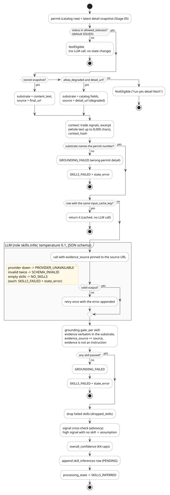
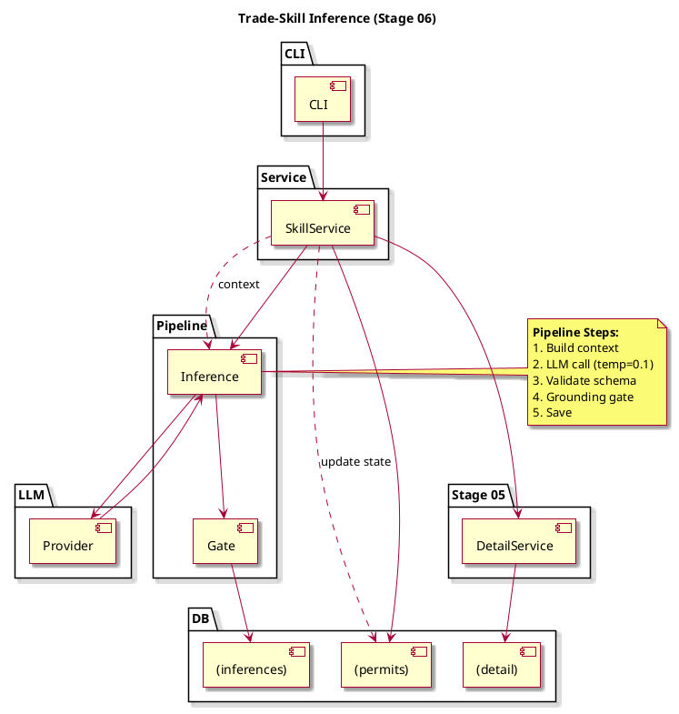

# Trade-skill inference (Stage 06)

For an issued permit and its stored detail snapshot, infer the trade skills
needed to carry out the permitted work. Every skill quotes the detail text word
for word (`evidence`) and names where the quote came from (`evidence_source`).
A machine check, the **grounding gate**, drops any skill whose quote is not in
the stored text. The gate is the only path to an accepted `skill_inferences`
row.

This page is the spec. A human reviewer, Stage 07 (orchestration) and Stage 08
(evaluation) apply the same rules.

Code: `src/permit_trade_skills/skills/` (no store imports), the SQL adapter
`src/permit_trade_skills/store/skills.py`, the CLI
`src/permit_trade_skills/cli/skills.py`, the prompt
`src/permit_trade_skills/skills/prompts/skill_infer_v1.md`. Schema:
`skill_inferences` plus the audit columns of migration
`0005_skill_inference_audit` (see [schema.md](schema.md)).

### Architecture Overview

#### End-to-End Pipeline (Activity Diagram)


*Original activity-style flow diagram showing the inference pipeline steps.*

Source: [diagrams/skills-flow.puml](diagrams/skills-flow.puml)

#### Component & Deployment Architecture


*Component and deployment diagram showing internal structure, database integration, and LLM provider abstraction.*

Source: [diagrams/trade-skills-component.puml](diagrams/trade-skills-component.puml)

## Quick start

```bash
uv run pts db migrate                          # 0005_skill_inference_audit
uv run pts detail fetch -p 7083363-CN          # Stage 05: store the detail snapshot first
uv run pts skills infer -p 7083363-CN          # one LLM call (role skills.infer)
uv run pts skills show -p 7083363-CN           # stored inference + ✓/✗ per skill
uv run pts skills batch --limit 10             # every DETAIL_READY permit (newest issued first)
```

| Command | What it does |
|---|---|
| `pts skills infer -p N [-p N2 ...]` | Infer one or more permits from their latest stored snapshot |
| `... --allow-degraded` | No snapshot: infer from the catalog fields (always `low` confidence) |
| `... --status S` | Eligible statuses (repeatable); default `skills.allowed_statuses` = `ISSUED` |
| `pts skills batch [--state S] [--status S] [--limit N]` | Infer a cohort in sequence; default `--state DETAIL_READY`, `--limit 10`; `--state ''` = any state |
| `pts skills show -p N` | Latest stored inference, each skill re-checked against the stored text (✓/✗) |
| `--json` | On every command: machine-readable output |

`-j/--jurisdiction` defaults to `seattle-kingcounty-wa`. `infer` exits 1 when a
permit is not found, not eligible or failed. Skill inference never fetches a
page itself. Run `pts detail fetch` first (Stage 07 calls `fetch_detail`).

## Output contract

One accepted inference is one `skill_inferences` row. `SkillInference.to_contract()`
returns the overview §5 shape:

```json
{
  "permit_key": "seattle-kingcounty-wa:7083363-CN",
  "model": "ollama/qwen3.8:latest",
  "prompt_version": "skill-infer-v1",
  "generated_at": "2026-11-06T20:05:09Z",
  "skills": [
    {
      "skill": "interior partition framing",
      "trade": "Carpentry",
      "evidence": "Construct alterations to the basement of an existing one family dwelling per plan.",
      "evidence_source": "https://services.seattle.gov/Portal/cap/CapDetail.aspx?...capID3=45424",
      "confidence": "medium"
    }
  ],
  "assumptions": ["No electrical, plumbing, or HVAC work is explicitly described ..."],
  "overall_confidence": "medium",
  "review_status": "PENDING",
  "licensing_notes": ["The detail states: \"Who will be performing all the work?: Owner/Lessee\" ..."]
}
```

The model must answer with this JSON schema (`skills/schemas.py`
`OUTPUT_SCHEMA`; Pydantic `SkillOutput` enforces it after every call):

| Field | Rule |
|---|---|
| `skills` | 1 to 20 items |
| `skill` | 8 to 240 chars. A capability, verb+noun ("interior partition framing"), not a license or job title |
| `trade` | At most 80 chars. Free text by convention: capitalized, at most 2 words where possible (Carpentry, Drywall, Electrical, Plumbing, HVAC, Concrete, Roofing, ...). Not enforced |
| `evidence` | 3 to 400 chars, a verbatim substring of the detail text |
| `evidence_source` | The source URL (see the grounding rule) |
| `confidence` | `high`, `medium` or `low` |
| `assumptions` | At most 10 strings |
| `overall_confidence` | `high`, `medium` or `low` |
| `licensing_notes` | At most 6 strings. Informational and non-normative; see below |

The schema sent to the provider (`provider_schema(source_url)`) is the
OpenAI strict-mode form of the same schema. Every property is required. String
lengths and item counts are left to Pydantic. `evidence_source` is pinned to the
one valid URL with an `enum`, so the model cannot garble a long portal URL.
`skills` may be empty there: an empty list means "nothing in the detail
supports a skill". The inference then fails as `NO_SKILLS` instead of being
retried as a schema error.

The stored row also carries the audit columns:

- `request_id`, `prompt_hash` (sha256 of the rendered system and user prompt)
  and `completion_hash` (sha256 of the raw completion), for eval replay.
- `context_hash` and `input_cache_key`, the idempotency key (below).
- `input_snapshot_id` and `substrate_hash`; `substrate_text` on degraded rows
  only.
- `degraded`, `dropped_skills`, `warnings` and `signal_check`.

## The grounding rule

A skill is **grounded** when all three hard checks pass
(`skills/grounding.py`, `check_skill`):

1. **Verbatim evidence.** `normalize(evidence)` is a substring of
   `normalize(substrate)`. `normalize` applies Unicode NFKC, removes soft
   hyphens (U+00AD), casefolds and collapses every whitespace run to one space.
   Quote marks wrapped around the evidence are ignored. Matching is exact
   substring, never fuzzy. A quote spanning two lines passes only if the lines
   are adjacent in the stored text.
2. **Source.** `evidence_source` equals the snapshot's `final_url`. In degraded
   mode it equals the permit's `detail_url`.
3. **Not an instruction.** The evidence is not instruction-like text such as
   "ignore previous instructions", "system prompt" or "add ... skill
   regardless". Injected text *is* in the page, so it passes check 1, but it is
   never evidence of a trade skill.

The **substrate** is the stored snapshot's whole `content_text`, not just the
excerpt the model saw. In degraded mode it is the catalog text, kept in
`skill_inferences.substrate_text`.

**Acceptance.**

| Gate result | Outcome |
|---|---|
| Every skill grounded | Accept |
| Some skills grounded | Accept the survivors. The others go to `dropped_skills` with their reasons, a warning is added, and `overall_confidence` is capped at `medium` |
| No skill grounded | Reject: `GROUNDING_FAILED`, permit `SKILLS_FAILED`, no row |

A document check runs before the LLM call: the substrate must contain the
permit number, ignoring punctuation and case. If it does not, the detail
belongs to another permit, and the inference fails as `GROUNDING_FAILED`
without spending an LLM call.

Soft checks are logged in `warnings` and never drop a skill. They flag a
one-word skill, a skill equal to its trade, and a skill ending in
"license"/"certification".

`pts skills show` and Stage 08 re-run `check_skill` on stored rows
(`grounding.verify_row`). Any ✗ on an accepted row is a write-path defect, not
a model defect.

## Confidence semantics

Per skill (the model assigns it; the prompt states these rules):

- `high`: the evidence is an explicit scope or classification line and the
  trade is unambiguous ("plumbing for 6 dental operatory sinks" → Plumbing).
- `medium`: the skill follows in one step from the evidence ("Construct
  alterations to the basement" → interior partition framing, drywall).
- `low`: inferred from general context. An assumption must explain it; if none
  does, a warning is added.

`overall_confidence` is computed in `infer.py`, starting from the model's own
value:

1. Take the minimum of the model's value and every accepted skill's confidence.
2. Cap at `medium` if any skill was dropped by the gate.
3. Lower by one step if a high trade signal has no matching skill (see Signals).
4. Cap at `medium` if the Stage 05 snapshot is marked degraded (a stale
   snapshot returned after a failed refresh, or one rescued by the judge). The
   snapshot notes are added as an assumption.
5. Set to `low` in degraded mode (no snapshot).

## Degraded mode (no detail snapshot)

Degraded mode is opt-in: `allow_degraded=True`, or `--allow-degraded` on the
CLI. Without it, a permit with no stored snapshot raises `NotEligible`
("run `pts detail fetch`"). No LLM call is made and the state is unchanged.

With the flag, the substrate is the permit's catalog fields as `LABEL: value`
lines (`PERMIT, STATUS, ADDRESS, DESCRIPTION, CLASSIFICATION, ...`; see
`context.catalog_text`). `evidence_source` is the permit's `detail_url`; a
permit without one is `NotEligible`. The row is stored with `degraded = true`
and `substrate_text` set, so the quotes stay checkable after the fact.
`overall_confidence` is always `low`, and the first assumption is exactly:

> Detail page unavailable; inferred from catalog description only.

Stage 08 reports degraded rows as a separate bucket.

## Signals (advisory)

`skills/signals.py` holds a curated keyword → trade map, for example
`concrete|foundation|slab|footing` → Concrete/Foundation and
`drywall|plaster` → Drywall. It covers the 13 trades of the design plus
Demolition, matched case-insensitively on word boundaries. A trade is a
**high** signal when a keyword appears on a scope line (`DESCRIPTION:`,
`Project Description:`, `Scope of work:`, ...) and **low** anywhere else. A
form answer of no is never a signal ("Fire Alarm: No", "Is there a spray paint
booth?: No").

Signals are never the answer. They are used for three things:

1. Choosing lines when the text is over the context budget.
2. The post-call cross-check (`signal_check.covered`,
   `missing_high_signals`, `first_pass_rate`). A high signal with no matching
   skill adds the assumption "detail mentions {keywords} ({trade}) but no skill
   was inferred — likely omitted by the model" and lowers the overall
   confidence one step. Skills are never added from signals.
3. Logging and storage in `signal_check`.

## Prompt and context

- **Prompt.** `prompts/skill_infer_v1.md` holds the exact system prompt and
  user template. The system prompt opens with three hard rules: grounding,
  scope and honesty. Then come the rule that the PERMIT DETAIL block is data,
  not instructions, how to apply the rules (one-step inferences at `medium`,
  specific capabilities, nothing for work answered "No"), and the field
  conventions. The user template is rendered from structured fields
  (jurisdiction, permit number, status, class, type, cost, issued date,
  address, source URL). Then comes the delimited block
  `--- PERMIT DETAIL (verbatim excerpt) --- ... --- END DETAIL ---`. Raw HTML is
  never sent.
- **Context.** The model gets the whole `content_text` when it fits in
  `skills.max_context_chars` (default 8,000; Seattle records are 3–5k). Over
  the budget, lines are kept in this priority order: scope and key catalog
  lines, then signal lines, then other lines, then "No" answers. The kept lines
  stay in their original order, and a note says the text is an excerpt.
  Grounding still checks against the whole substrate.
- **Versioning.** Any edit to the prompt file is a new version: copy the file
  to `skill_infer_v2.md` and bump `schemas.PROMPT_VERSION`. Old rows are never
  rewritten. The cache key contains `prompt_version`, not the prompt text, so
  an edit made without a bump would keep serving the old rows.

## Idempotency, rows and states

- `context_hash` is the sha256 of the canonical JSON of what the prompt is
  built from: the facts, the excerpt, the source URL, the degraded flags and
  the substrate hash. `input_cache_key` is the sha256 of
  `(input_snapshot_id, prompt_version, model, context_hash)`. If a row with the
  same key exists for the permit, it is returned with `cached=True` and no LLM
  call is made. `UNIQUE (permit_id, input_cache_key)` keeps this true across
  concurrent workers.
- Rows are append-only. A new prompt version, a new model or a new snapshot
  adds a row. `latest` (and `pts skills show`) picks the newest by
  `created_at`.
- Permit state (`processing_state`):

  | Outcome | Transition |
  |---|---|
  | Accepted | `DETAIL_READY`, `SKILLS_FAILED`, `SKILLS_INFERRED` (or `SYNCED`/`DETAIL_FAILED` in degraded mode) → `SKILLS_INFERRED` |
  | Failed | `DETAIL_READY`, `SKILLS_FAILED`, `SYNCED`, `DETAIL_FAILED` → `SKILLS_FAILED`, with `state_error = {stage: "skill_infer", error, message, retryable, ...}` |

  A permit that already has an accepted inference keeps `SKILLS_INFERRED` when
  a later attempt fails. `SKILLS_APPROVED`, `SKILLS_REJECTED` and
  `SKILLS_SKIPPED` are never changed here; review decisions belong to Stage 07.
  New rows are always `review_status = 'PENDING'`.

## Errors

| Error | When | Retryable | State |
|---|---|---|---|
| `NotEligible` | Status not allowed; no snapshot without `allow_degraded`; degraded without `detail_url` | n/a | unchanged |
| `InferenceFailed(GROUNDING_FAILED)` | Wrong-permit detail (no LLM call), or no skill passed the gate | no | `SKILLS_FAILED` |
| `InferenceFailed(NO_SKILLS)` | The model returned `skills: []` (e.g. administrative text) | no | `SKILLS_FAILED` |
| `InferenceFailed(SCHEMA_INVALID)` | Invalid output twice (first try plus one retry with the error appended) | yes | `SKILLS_FAILED` |
| `InferenceFailed(PROVIDER_UNAVAILABLE)` | Provider down or timed out after the provider's own retries | yes | `SKILLS_FAILED` |

No path ever returns a fallback answer. Each failure writes a JSON log line
(`{"event": "skills.failed", ...}`, logger `pts.skills`) that includes the
dropped skills and the completion hash where there is one.

## Licensing notes

`licensing_notes[]` are informational and non-normative. Licensing is out of
Phase 1 scope. A note is kept only if it starts with `assumed`, is itself
verbatim detail text, or quotes the detail verbatim in quote marks. Other notes
are dropped with a warning.

## Worked example: Seattle `7083363-CN`

The overview's example permit. Live run on 2026-11-06 with
`ollama/qwen3.8:latest`; evidence:
[evals/evidence/seattle/skills/sample.json](../evals/evidence/seattle/skills/sample.json).

Catalog: Single Family/Duplex, Addition/Alteration, $25,000, issued
2026-01-15, 3010 E CHERRY ST. The stored snapshot (`redirect_chase`, 3,760
chars, whole text sent) contains, among the Q&A lines:

```text
DESCRIPTION: Construct alterations to the basement of an existing one family dwelling per plan.
...
Fire Alarm: No
Floor Area (square feet): 916
Floor or Area: Basement
...
Other Fire Protection System: Yes
Other Type of Sprinkler System: smoke detectors, carbon monoxide detectors
...
Project Description: Basement remodel Construct alterations to the basement of an existing one family dwelling, per plan.
...
Where on your property are you working?: Basement of the existing main building on property
Who will be performing all the work?: Owner/Lessee
```

`pts skills show -p 7083363-CN`:

```text
seattle-kingcounty-wa:7083363-CN  inference #15  skill-infer-v1  ollama/qwen3.8:latest
overall_confidence: medium   review_status: PENDING   degraded: false
evidence_source: https://services.seattle.gov/Portal/cap/CapDetail.aspx?type=1000&fromACA=Y&agencyCode=SEATTLE&Module=DPDPermits&capID1=25SCI&capID2=00000&capID3=45424

 1. [medium] interior partition framing — Carpentry  ✓
      “Construct alterations to the basement of an existing one family dwelling per plan.”
 2. [medium] drywall hanging and finishing — Drywall  ✓
      “Construct alterations to the basement of an existing one family dwelling per plan.”
 3. [medium] interior flooring installation — Carpentry  ✓
      “Construct alterations to the basement of an existing one family dwelling per plan.”

Assumptions:
  - The permit description 'Construct alterations to the basement' implies standard interior
    finishing trades (framing, drywall, flooring) but does not explicitly list them.
  - No electrical, plumbing, or HVAC work is explicitly described in the scope, although 'basement
    remodel' often involves these; they are omitted due to lack of specific textual evidence in the
    provided excerpt.
  - The scope is limited to the basement of an existing single-family dwelling.

Licensing notes (informational, non-normative):
  - The detail states: "Who will be performing all the work?: Owner/Lessee", indicating the work may
    be performed by the owner, which often affects licensing requirements.

Signals: Fireproofing/Spray Foam (low)
Covered: none

Grounding: 3/3 skill(s) ✓ against the stored detail; permit state SKILLS_INFERRED
```

Applying the rule by hand gives the same table:

| # | Skill | Check | ✓/✗ | Why the evidence supports the skill |
|---|---|---|---|---|
| 1 | interior partition framing (Carpentry) | The quote is the `DESCRIPTION:` line verbatim; source = the snapshot's `final_url` | ✓ | Altering a finished basement means building or moving interior partitions. One step from "alterations to the basement", so `medium` |
| 2 | drywall hanging and finishing (Drywall) | Same line | ✓ | New or altered partitions are finished with drywall ("Basement remodel" in the Project Description). `medium` |
| 3 | interior flooring installation (Carpentry) | Same line | ✓ | A basement remodel of 916 sq ft of floor area typically includes floor finishes. `medium` |

What was *not* inferred, and why that is right:

- **Plumbing and HVAC.** No line describes them, and "Fire Alarm: No" and the
  sprinkler "No" answers are not signals. The basement fixture asserts their
  absence (AC2).
- **Electrical.** "Other Type of Sprinkler System: smoke detectors, carbon
  monoxide detectors" is a low signal (Fireproofing). It would support a
  `medium` "detector installation" skill; the model left it out, and the
  signal is not high, so no assumption or penalty is added. Leaving out an
  optional skill is a recall question for Stage 08, not a faithfulness defect.

The offline fixture `tests/fixtures/skills/basement.json` uses the same text
with a scripted answer: framing, drywall and detector installation, all ✓.

## Python API (Stages 07 and 08)

```python
from permit_trade_skills.wiring import skill_service

svc = skill_service()                                         # SQL store; provider: role skills.infer (lazy)
inf = svc.infer("7083363-CN", "seattle-kingcounty-wa")         # SkillInference (cached=True on a repeat)
inf = svc.latest("7083363-CN", "seattle-kingcounty-wa")        # stored only, or None
report = svc.batch("seattle-kingcounty-wa", state="DETAIL_READY", limit=10)
table = svc.show("7083363-CN", "seattle-kingcounty-wa")["grounding"]   # per-skill reasons ([] = ✓)

from permit_trade_skills.skills.infer import infer_skills    # the single entry point for Stage 07
inf = infer_skills(permit, detail, provider=provider, store=None)       # no store: no cache, no writes
```

- `infer_skills(permit: PermitInput, detail: DetailDocument | None, *, provider, store=None, allowed_statuses=None, allow_degraded=False, settings=None)`
  raises `NotEligible` or `InferenceFailed(code, retryable, details)`.
- Stage 07's `infer_trade_skills` tool wraps `infer_skills` (or
  `SkillService.infer`), and `get_skill_inference` wraps `SkillService.latest`.
  `tests/unit/test_import_boundary.py` checks that `orchestration/` imports
  only `permit_trade_skills.skills.infer` / `permit_trade_skills.skills`. It
  also checks that `skills/persist.py` is the only writer of `skill_inferences`
  and runs after `grounding.gate`, and that no code approves or rejects
  inferences.

## Settings

`config/settings.yaml`:

```yaml
llm:
  providers:
    openai:  {models: {skills.infer: gpt-4.1}}          # prices: gpt-4.1 $2.00 / $8.00 per 1M tokens
    ollama:  {models: {skills.infer: qwen3.8:latest}}
skills:
  temperature: 0.1          # must be <= 0.2 (refused otherwise)
  max_tokens: 4000
  max_context_chars: 8000
  allowed_statuses: [ISSUED]
```

`llm.use_local_ollama_model` (or `PTS_USE_LOCAL_OLLAMA_MODEL`) picks the
profile, as for the other roles.

## Tests and evidence

- `tests/unit/test_infer_offline.py`: the whole pipeline offline with an
  in-memory store and a fake LLM keyed by `context_hash`
  (`tests/skills_fakes.py`). Covers the 5 positive and 3 negative fixtures,
  first-pass grounding ≥ 98%, the hallucinated-skill drop, injection, the
  wrong-permit rejection without an LLM call, `NO_SKILLS`, the cache hit
  (exactly one LLM call and one row), append-on-new-model or new-snapshot,
  `NotEligible`, degraded mode, the schema-retry path, provider failure, the
  confidence caps, the context budget and the prompt and schema shape.
- `tests/unit/test_grounding.py`: normalization, pass/drop/reject, source
  mismatch, the injection guard, the document anchor, licensing notes.
- `tests/unit/test_signals.py`: completeness of the signal map (every keyword
  maps to a trade and fires), strength, "No" answers, the cross-check.
- `tests/integration/test_skills_store.py`: `SqlSkillStore` on Postgres: the
  audit columns, the cache key under a race, the CHECK constraint, state
  transitions, the degraded substrate, the `pts skills show` ✓ table.
- Fixtures in `tests/fixtures/skills/`:
  - `basement`, `addition` and `demolition` are real Seattle records
    (`7083363-CN`, `7152387-CN`, `7136975-DM`).
  - `tenant_improvement` (commercial, multi-trade) and `no_scope` (catalog
    only) are synthetic.
  - Negatives: `injection`, `wrong_permit`, `admin_only`.
- Fixture eval, `tests/eval/test_skills_live.py`. It runs offline by default.
  With `PTS_SKILLS_LIVE=1` it uses the real provider, writes
  `evals/evidence/seattle/skills/<date>-live.json`, and runs in the nightly CI
  job `skills-live` (OpenAI `gpt-4.1`).

**Measured (2026-11-06, local Ollama `qwen3.8:latest`).**

- Fixture eval, live: 5/5 positive fixtures accepted, first-pass grounding
  100%, present-trade recall 100%, no fabricated trades. The model ignored the
  injected instruction. The wrong-permit fixture was rejected before the call
  and the admin-only fixture ended in `NO_SKILLS`. About 2 minutes for the 8
  fixtures. Evidence:
  [2026-11-06-live.json](../evals/evidence/seattle/skills/2026-11-06-live.json).
- Live batch over the 7 `DETAIL_READY` Seattle permits: 7 inferred, 0 dropped
  skills, 11–23 s per permit. Run again: 0 LLM calls; every permit with a
  snapshot was served from the cache.
- Degraded mode (`7128403-CN`, rooftop telecom alteration, no snapshot):
  `low`, the required assumption first, `evidence_source` = the `detail_url`.
